# VulnScope — System Architecture

| Field | Value |
|---|---|
| Status | **APPROVED v0.2 — Task 00.2 (approved by owner 2026-10-14, documentation/design level)** · Erratum E-01 applied 2026-10-14 (§9.4) · Erratum E-02 applied 2026-10-15 (§18 AR-10) |
| Date | 2026-10-14 |
| Changelog | **v0.2:** lifecycle outcomes and rule-specific resolution (§10.1–§10.4) · invite-only registration (§7.1) · scanner credentials, ACL and compromise analysis (§9.4) · redirect semantics, no `pass` for unauthorized hosts (§9.3) · current vs historical score (§11.1) · control verification vs authorization (§8.4). **v0.1:** initial draft |
| Inputs | `docs/PRD.md` v0.2 (approved), `docs/DECISIONS.md`, build contract |
| ADRs | `docs/adr/` (index in §20) |
| Follow-ups | 00.3 threat model & rules of engagement · 00.4 ERD, API contracts, permissions matrix, backlog |

This document describes **how** VulnScope is structured and **why**. It contains no code. Exact library versions are verified and pinned in Task 01.1. Numeric limits marked *(RoE)* are finalized in 00.3.

---

## 1. Architectural drivers

| Driver | Source | Architectural consequence |
|---|---|---|
| Never scan what the user hasn't proven they own and explicitly authorized | PRD FR-03, DEC-003 | Authorization checked at enqueue **and** enforced again inside the scanner via a signed scope token (§8, §9) |
| Scanner must not become an SSRF gateway into our infrastructure | Contract §6 | Scanner is a separate workload in its own network zone, holding only scan-broker credentials, with network-level egress rules (§4, §9.4) |
| No cross-tenant leaks | PRD FR-04 | Org-scoped API paths, membership resolved server-side, org-scoped repositories, 404 on foreign IDs (§7) |
| Findings are deterministic; AI never decides | FR-01, FR-08 | Rule engine is pure functions over a bounded observation snapshot; only verified scans drive lifecycle (§10) |
| Honest score and coverage | §7 PRD, DEC-011 | Score eligibility computed from rule-result determinacy, not from a "%" threshold (§11) |
| Three data trust levels | §8 PRD, DEC-012 | Extension data stored in a separate table/type, never joined into lifecycle or score (§13) |
| Solo builder, small budget | PRD R-11, Contract §3 | **Modular monolith** + 2 worker pools, no microservices, free local stack (ADR-0001) |
| RTL-ready, English MVP | DEC-010 | i18n string catalog and logical CSS from 01.2; reports parameterized by locale |

## 2. System context and containers

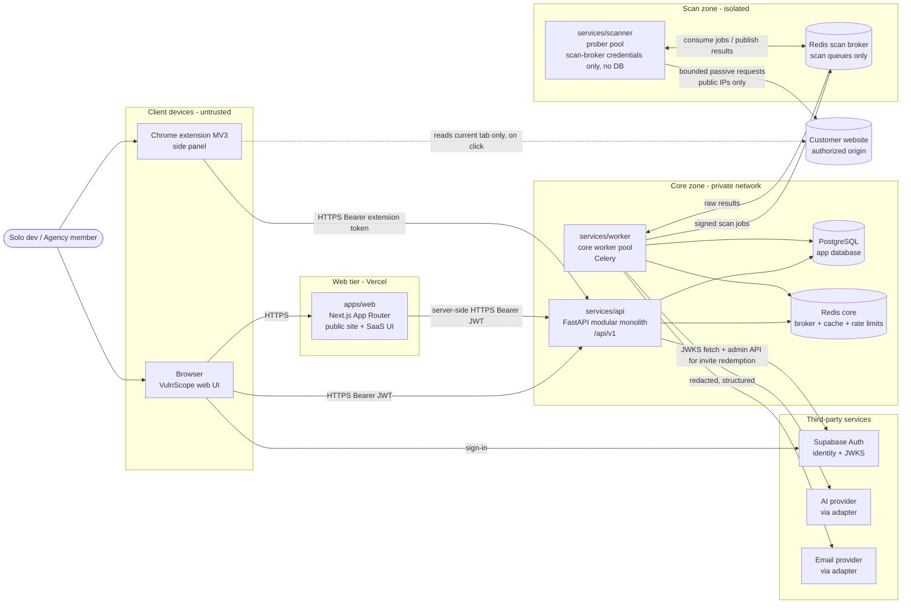

### 2.1 Component responsibilities

| Component | Responsible for | Must never |
|---|---|---|
| **apps/web** (Next.js) | Public site, SaaS UI, Supabase session handling in the browser, server-rendered pages that call the API with the user's token | Hold service credentials · talk to Postgres/Redis · fetch arbitrary user URLs · decide authorization (UI hiding is cosmetic only) |
| **services/api** (FastAPI) | All business logic and authorization: orgs, RBAC, projects, verification state, scan enqueue, findings, AI requests, reports metadata, usage, extension sync, audit log | Fetch customer URLs or resolve customer DNS · trust client `org_id`/role · return data without org filter |
| **services/worker** (core pool) | Async jobs that need DB access: process scan results → findings, AI generation, report rendering, notifications, schedules, revalidation orchestration, retention cleanup | Contact customer websites · accept scanner output without schema/size validation |
| **services/scanner** (prober pool) | The *only* component that touches customer infrastructure: DNS TXT lookups, HTTPS well-known fetches, HTTP/TLS passive observation. Holds **only** scan-broker ACL credentials and public verification keys (§9.4) | Hold DB/Redis-core/Supabase/AI/email credentials or the signing private key · reach private networks · follow redirects automatically · execute JavaScript · store data |
| **apps/extension** (MV3) | User-initiated passive observation of the current tab, local display, explicit sync to a verified project, deep links | Run in background on pages · read form values, cookie values, tokens · load remote code · claim ownership |
| **PostgreSQL** | System of record (tenants, projects, verification, scans, rule results, findings, audit) | Be reachable from web, extension, or scanner |
| **Redis core** | Celery broker for core jobs, rate-limit counters, short caches, kill-switch flag | Be reachable from the scanner |
| **Redis scan broker** | Only scan/probe job queues and their results | Hold anything except signed jobs and size-bounded results |
| **Supabase Auth** | Identity: email verification, password set/reset, sessions, JWT issuance. **Public sign-up disabled**; identities are created only by our API after invite redemption (§7.1) | Store our authorization data (roles/memberships live in our Postgres) · allow self-service sign-up during beta |
| **AI provider** | Text generation from redacted, structured, grounded input | Receive raw evidence, secrets, PII, or untrusted page content as instructions |

## 3. Inside the API: a modular monolith

One deployable FastAPI service, split into modules with explicit boundaries. Modules talk to each other through service-layer interfaces, never through each other's tables.

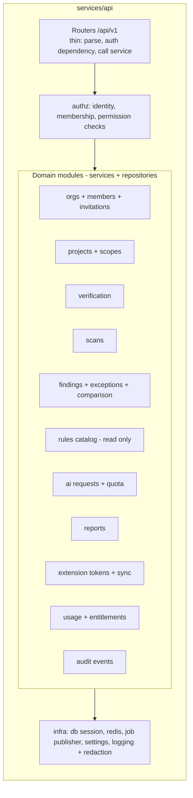

Proposed repository layout (created in 01.1, not now):

```
apps/web            Next.js
apps/extension      Chrome MV3
services/api        FastAPI app + Alembic migrations
services/worker     Celery core worker (imports shared domain package)
services/scanner    Prober: collector + DNS/HTTP/TLS clients + egress guard
packages/rules      Python package: versioned deterministic rules (pure functions) + fixtures
packages/contracts  Shared schemas: OpenAPI-generated TS types, scan job/result JSON Schemas
infra/              docker-compose, network policy examples, fixture servers
docs/               PRD, ARCHITECTURE, adr/, state docs
```

Why `packages/rules` is separate: rules are evaluated in the **core worker** (trusted zone) over the raw observation snapshot the scanner returns. The scanner only *collects*; it never *judges*. That keeps the scanner tiny, and lets rules be unit-tested against fixtures without any network (ADR-0010).

## 4. Deployment topology and network zones

| Zone | Contains | Inbound allowed | Outbound allowed |
|---|---|---|---|
| Z0 Internet clients | Browsers, extension | — | Web, API, Supabase |
| Z1 Web tier | Next.js on Vercel | Internet (443) | API (443), Supabase |
| Z2 Core zone | API, core worker, Postgres, Redis core | API: from internet via load balancer (443) only · DB/Redis: from Z2 only | Supabase JWKS, AI provider, email provider, Redis scan broker — **allowlist** |
| Z3 Scan zone | Scanner, Redis scan broker | Broker: from core worker and scanner only | Scanner: broker + **public unicast IPs on TCP 80/443 + UDP/TCP 53 to the configured resolver**. Everything else denied |

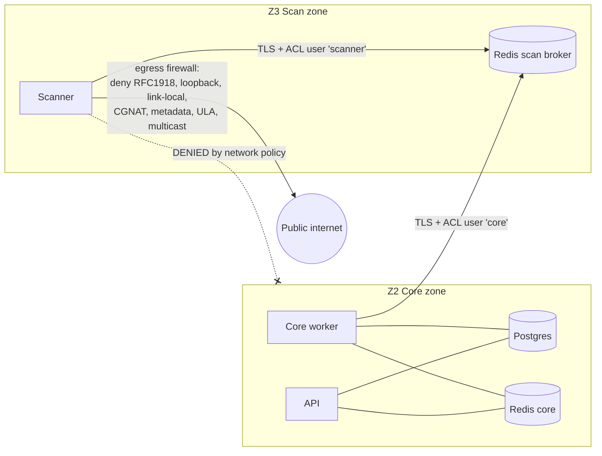

**Local development (Docker Compose, 01.1):** two Docker networks — `core_net` (api, worker, postgres, redis-core) and `scan_net` (scanner, redis-scan, **fixture servers**). The worker is attached to both; the scanner only to `scan_net`. By default the local scanner runs with `SCANNER_ALLOW_EXTERNAL=false`, so it can only reach fixture servers; CI never enables external scanning (Contract §6). Full egress firewalling is a production property; locally it is approximated and documented as such.

**Production target:** web on Vercel; API, worker, scanner as containers on a managed platform that supports **per-service egress rules** (platform choice = open decision OAD-03). Managed Postgres and Redis. The scanner runs in a separate network/VPC segment from Z2.

## 5. Trust boundaries

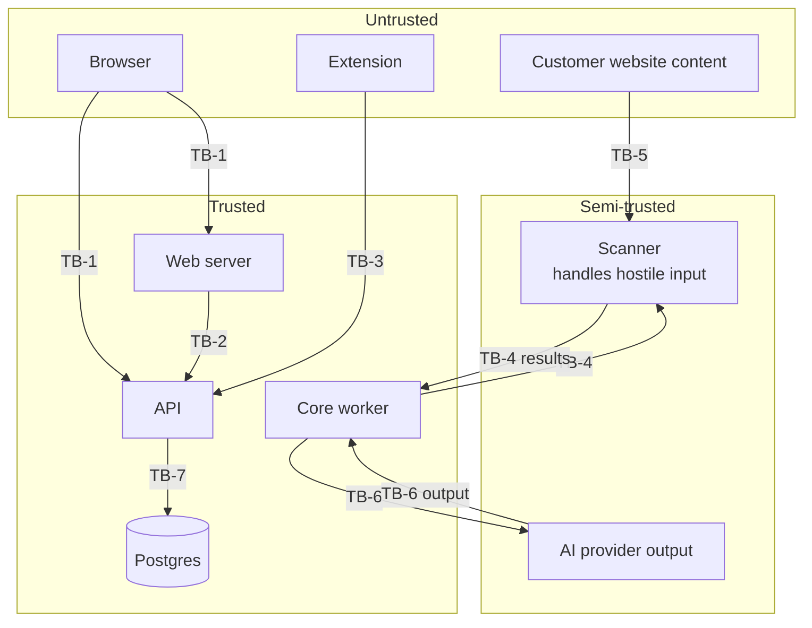

| ID | Boundary | What crosses | Controls |
|---|---|---|---|
| TB-1 | Browser → Web/API | User requests, Supabase access JWT | TLS · JWT verification (sig/iss/aud/exp) · CORS allowlist · input validation (Pydantic) · rate limits · strict CSP on our app |
| TB-2 | Web server → API | Server-rendered requests on the user's behalf | Same JWT as user (no privileged service token) · TLS |
| TB-3 | Extension → API | Extension token, sanitized observations | Scoped, revocable, hashed-at-rest token · schema + size limits · origin must match a verified project scope |
| TB-4 | Core worker ↔ Scanner | Signed scan job → raw observation snapshot | Ed25519-signed scope token · separate broker + ACL · results treated as **untrusted**: JSON Schema, size caps, string truncation, no HTML rendering |
| TB-5 | Customer site → Scanner | Hostile HTTP/TLS/DNS responses | Egress guard per connection · no auto-redirects · response size/time caps · no JS execution · parser hardening |
| TB-6 | Worker ↔ AI provider | Redacted structured finding context → generated text | Redaction · untrusted content wrapped as data · output JSON Schema validation · rendering as escaped text/markdown subset · budget caps |
| TB-7 | API/worker → Postgres | Queries | Least-privilege DB roles · parameterized ORM · org-scoped repositories · optional RLS (OAD-01) |
| TB-8 | Local extension data → Cloud | Only on explicit "Sync" | See §13 — stored as `extension_observations`, never as findings |
| TB-9 | API/worker → Supabase Admin API | Identity creation and deletion for beta invites | Service-role key only in the core zone; called only after atomic invite redemption (§7.1); every call audited |

## 6. Component communication and authentication

| From → To | Transport | Authenticates with | Authorizes by |
|---|---|---|---|
| Browser → Supabase | HTTPS | Email + password, email verification | Supabase |
| Browser → Web | HTTPS | Supabase session cookies (`Secure`, `SameSite=Lax`) | Next.js middleware redirects unauthenticated users (UX only) |
| Browser / Web server → API | HTTPS | `Authorization: Bearer <Supabase access JWT>` | API: membership + role per org (§7) |
| Extension → API | HTTPS | `Authorization: Bearer <extension token>` (opaque, scoped) | API: token scopes + membership + project verification |
| API → Supabase | HTTPS | — | Fetch/cached JWKS for signature verification |
| API → Postgres | TLS | DB role `vs_app` (DML only); migrations use `vs_migrator` | DB grants |
| API / worker → Redis core | TLS (prod) | Redis ACL user | ACL key patterns |
| Worker → Redis scan | TLS (prod) | ACL user `core` (publish jobs, read results) | ACL |
| Scanner → Redis scan | TLS (prod) | ACL user `scanner`, Redis Streams protocol (no Celery on the scanner side) | Minimum ACL in §9.4 |
| API → Supabase Admin API | HTTPS | Service-role key, held only in the core-zone secret store (API + core worker) | Used only by invite redemption, reconciliation and cleanup (§7.1) |
| Worker → Scanner (logical) | via broker | Job carries **Ed25519-signed scope token**; scanner holds only the public key | Scanner verifies signature, expiry, scan_id, allowed origins before any request |
| Worker → AI / email | HTTPS | API key from secret store (never in DB, logs, or prompts) | Per-org budget/quota checked before call |
| Webhooks in (billing, later) | HTTPS | Provider signature + timestamp | Idempotency key table |

**Why Bearer tokens instead of cookies on the API:** the API never reads cookies, so CSRF cannot ride on ambient credentials; CORS is restricted to the web origin and the published extension ID. The trade-off is that the access JWT is readable by browser JS, so XSS defense (strict CSP, no `dangerouslySetInnerHTML` of untrusted content, escaped rendering) is mandatory. Alternative "Next.js BFF with HttpOnly cookie only" is recorded in ADR-0004.

## 7. Identity, organization isolation and RBAC

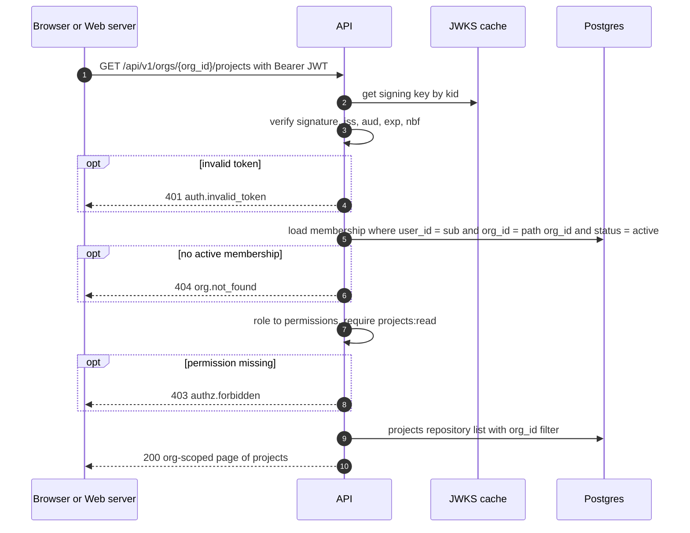

**Enforcement rules (defense in depth):**

1. **Identity** comes only from a verified JWT `sub` (or extension token → user). Nothing in the request body or headers can change it.
2. **Org context** comes from the URL path `/orgs/{org_id}/…` and is accepted only after an active membership is found. A client-sent `org_id` in a body is ignored.
3. **Permissions** are a static matrix `role → set(permission)` defined in 00.4 (owner, admin, analyst, viewer). Every route declares one required permission through a FastAPI dependency; a route without one fails a startup check (deny by default).
4. **Data access** goes through org-scoped repositories whose methods *require* `org_id`; queries for child objects join back to the org (e.g., finding → project → org). No raw unscoped query helpers in modules.
5. **Foreign or unknown IDs return 404**, not 403, to avoid enumeration.
6. **Background jobs** carry `org_id`, `project_id`, `initiated_by`. At execution they re-check that the project still exists, verification is still active, and (for user-initiated jobs) the initiator still has the permission. Revoked → job cancelled with reason.
7. **Optional Postgres RLS** as a second net (`SET LOCAL app.org_id` per transaction) — open decision OAD-01.
8. **Tests** (04.2): a cross-tenant suite where user A tries every endpoint with org B's IDs and must get 404/403 — this suite is a CI gate.
9. **Audit**: role changes, invitations, verification changes, scope authorization, scans, exceptions, exports, token revocations → `audit_events` (append-only for `vs_app`).

### 7.1 Invite-only registration (new in v0.2)

**Correction from v0.1:** v0.1 relied on "sign-up completes only with a valid invite checked by our API". A check that runs *after* sign-up can't stop an uninvited person from creating an identity at the provider. In v0.2, the invite is enforced **before any identity exists**. Public sign-up is disabled at Supabase, and only our API can create identities, and only after it atomically redeems an invite.

**Supabase-specific constraints.** Each one is verified in 03.1 and has a negative test in 03.4. Nothing here assumes an unsupported hook.

| ID | Constraint | Consequence |
|---|---|---|
| C1 | Supabase project setting *Allow new users to sign up* is **disabled** (local: `[auth] enable_signup = false` in `supabase/config.toml`). Expected: public `signUp`, passwordless/OTP sign-in with user creation, and first-time OAuth logins can't create users. | Primary control. Negative tests try each enabled method with an uninvited email and expect no user to be created. |
| C2 | Admin endpoints (invite user by email / generate invite link / create user) must still work with the service-role key while public sign-up is disabled. | Must be confirmed in 03.1. If not, 03.1 stops and we revisit. |
| C3 | The service-role key bypasses every Supabase restriction. | Stored only in the core-zone secret store (API + core worker). Never on Vercel, in the browser, or in the extension. Every use is audited (TB-9). |
| C4 | We **do not rely on Auth Hooks** (e.g., a "before user created" hook). Availability and behaviour depend on plan and version. | If 03.1 confirms such a hook is available, it may be added as an *extra* layer. Never the only one. |
| C5 | The built-in Supabase email sender is rate-limited and meant for development. | The beta needs custom SMTP. Provider and cost need owner approval (OAD-14). |
| C6 | MVP enables **email + password only** (with email confirmation). OAuth providers stay disabled until each is tested against C1. | Smaller attack surface. |
| C7 | Supabase's invite/confirmation link expiry is governed by its own OTP/link expiry setting, separate from our invite expiry. | Two clocks. The cleanup job reconciles both. |

**Data (detailed in the 00.4 ERD):** `beta_invites`
- `id`, `token_hash` (unique), `email_normalized` (**required**: every MVP invite is email-bound; unbound codes are out of scope), `status`, `expires_at`, `created_by`, `org_invitation_id` (nullable: a team invite also grants beta access), `redeem_attempt_id`, `redeem_started_at`, `supabase_user_id` (unique, nullable), timestamps.
- Partial unique index: one *live* invite per email (`status in pending, redeeming, provisioned`).

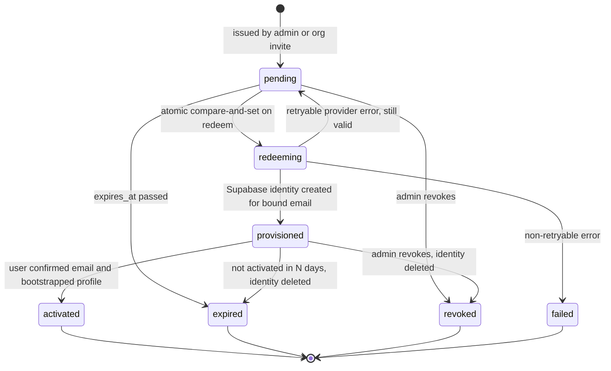

**Redemption flow**

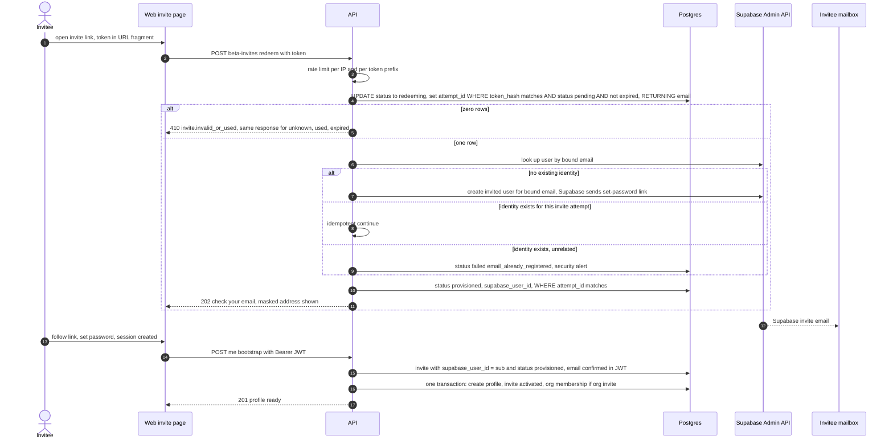

**Guarantees**
- **Atomic, single use.** The redeem step is one conditional `UPDATE … WHERE status = 'pending' AND expires_at > now() … RETURNING`. Under concurrency, the second request re-evaluates the predicate after the first commits and gets zero rows. Exactly one attempt wins.
- **Fencing.** Every later write is conditioned on `redeem_attempt_id`, so a slow or crashed attempt can't overwrite a newer one.
- **Email binding.** The identity is always created for `email_normalized`, never for an address the client sends. Forwarding the link can't redirect the account. The bound mailbox still has to confirm via Supabase's link.
- **Replay protection.** Tokens are 32 random bytes and stored hashed. They travel in the URL fragment, so they stay out of server logs and `Referer`. Once the status leaves `pending`, the token is dead. Unknown, used, and expired tokens get the same response, so nobody can enumerate invites.
- **Defense in depth.** `POST /me/bootstrap` refuses any `sub` without a `provisioned` invite: `403 beta.not_invited`, a security alert, and the identity is queued for disabling. This is the backstop. C1 is the gate.

**Cleanup and reconciliation** (scheduled core-worker jobs):

| Condition | Action |
|---|---|
| `pending` past `expires_at` | → `expired` |
| `redeeming` older than ~10 min (crashed between the CAS and the Supabase call) | Look up the bound email at Supabase. Identity exists → `provisioned`. Otherwise → `pending` if still valid, else `expired`. Fenced by attempt id. |
| `provisioned`, not activated after N days *(00.3)* | Delete the unconfirmed Supabase identity via the Admin API → `expired`. An admin may re-issue. |
| Supabase identity with no matching invite (misconfiguration or bypass) | Disable/delete the identity, raise a security alert |
| Admin revokes | `pending` → `revoked`. `provisioned` → `revoked` and the identity is deleted. |

## 8. Domain verification and scan authorization

### 8.1 Verification flow

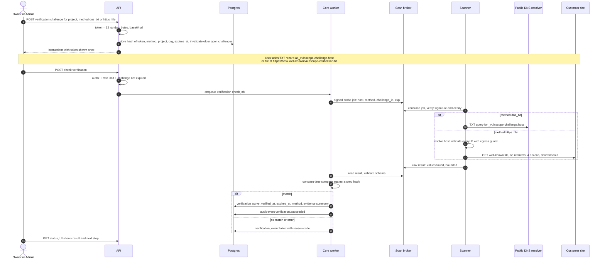

Key properties:
- Token is **single-use, short-lived** (challenge TTL e.g. 72 h *(RoE)*), stored hashed, bound to `(org, project, host, method)`. A new challenge invalidates older open ones → replay resistance.
- Verification is **per exact host**. Verifying `example.com` authorizes nothing about `www.example.com` or `api.example.com`.
- The HTTPS-file method accepts **no redirects** (a redirect to another host would let the proof live somewhere else).
- Verification is **time-bounded**: active verification has `expires_at` and is **re-checked** (same probe) before scheduled scans and when older than a threshold before manual scans (OAD-05). Failed revalidation → `revoked`, scans and sync blocked, owner notified. This addresses stale-proof / domain-transfer takeover.
- The API never performs the DNS or HTTP lookup itself — all customer-facing network I/O is in the scanner (ADR-0008).

### 8.2 Authorized scope

`authorized_scopes` records, per project, the exact set the scanner may touch:

| Field | Example | Rule |
|---|---|---|
| `host` | `example.com` | Lowercased, IDNA/punycode-normalized, no trailing dot, **must be a hostname, not an IP literal**, must equal a verified host |
| `https_port` | 443 | MVP: 443 only |
| `http_redirect_probe` | true | Allows exactly one `GET http://host:80/` without following redirects (§9.3) |
| `paths` | `/` + up to N paths *(RoE)* | Same-origin only; no crawling |
| `authorization_id` | → `scan_authorizations` row | The explicit consent record (§8.4); required and separate from verification |
| `status` | active / suspended / revoked | Suspended automatically if verification lapses or the authorization is revoked |

### 8.3 Scan authorization at enqueue

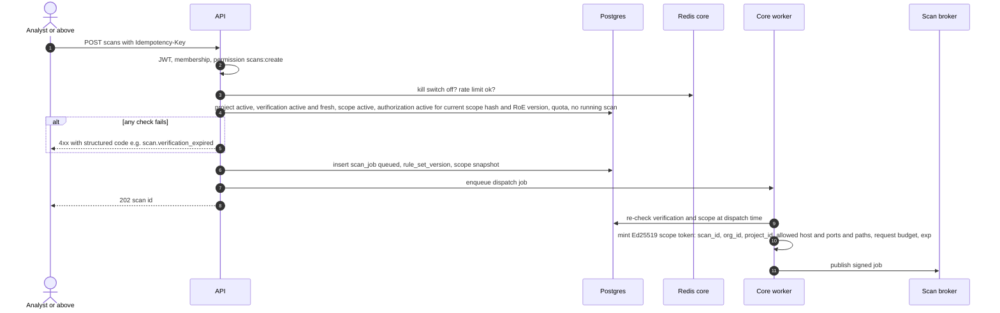

The scope token is the scanner's **only** source of truth about what it may contact. Even if the broker were compromised, a forged job without a valid signature is rejected, and a valid token can't be widened. This guarantee depends on intact scanner code. See §9.4 for what network isolation does and doesn't add.

### 8.4 Technical control vs authorization to scan (new in v0.2)

Verification and authorization answer **different questions**. A scan needs **both** to be active. Neither implies the other.

| | Technical control verification | Authorization to scan |
|---|---|---|
| Answers | "Could someone in this org place a DNS record or file on this host at time T?" | "Does this org assert a legal right to run these specific passive checks on this exact scope, under these rules?" |
| Mechanism | DNS TXT / HTTPS file challenge (§8.1) | Explicit consent by an owner/admin, with Rules of Engagement acknowledgment |
| Does **not** prove | Legal ownership or permission. Examples: an agency with DNS access but no contract covering testing, hosting staff, an attacker who can upload a file through a compromised CMS, a stale DNS delegation | Technical control of the host |
| Record | `verification_events` + verification `expires_at` | `scan_authorizations`: org, project, **scope snapshot hash** (hosts, ports, paths), `basis` (`asset_owner` / `written_authorization_from_owner`), optional reference note (e.g., contract ID; no document upload in MVP), `roe_version`, `consented_by`, `consented_at`, `expires_at` (optional, e.g., 12 months), `revoked_at`, `revoked_by` |
| Who | Any member with `verification:manage` | **Owner or admin only** |
| Becomes invalid when | Expiry, failed revalidation, revocation | Scope changes (hash mismatch), RoE version bump, consenting user loses owner/admin role *(policy confirmed in 00.3)*, explicit revocation, expiry, abuse complaint suspension |

Rules:
1. `POST scans` and every dispatch check that **both** records are active, and that the authorization's scope hash equals the current scope. Each `scan_job` stores `verification_id` and `authorization_id`.
2. Any change to hosts, ports, or paths, or a new RoE version, blocks scans until an owner/admin consents again. The UI shows a diff of what changed.
3. The consent screen shows the exact scope, the RoE summary, and the basis choice. Agencies must choose `written_authorization_from_owner`. Nothing is pre-checked.
4. Reports and the audit log show both: "Control verified via DNS TXT on date" and "Scanning authorized by user on date under RoE-n".
5. An abuse complaint about a host suspends its authorization **regardless of verification**, pending review (00.3).
6. The ToS makes the user responsible for the truth of their authorization claim. Legal review before public launch (PRD R-08).

## 9. Scan execution and scanner safety controls

### 9.1 Scan job state machine

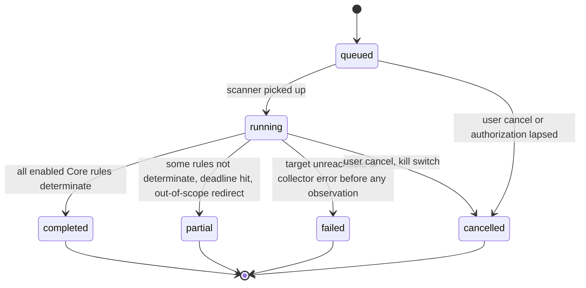

`partial`, `failed`, `cancelled` are never presented as clean and never get a headline score (§11).

### 9.2 Egress guard: every connection, every hop

The scanner uses a custom HTTP client that **resolves, validates, and pins** addresses itself; it never lets a library resolve and connect on its own.

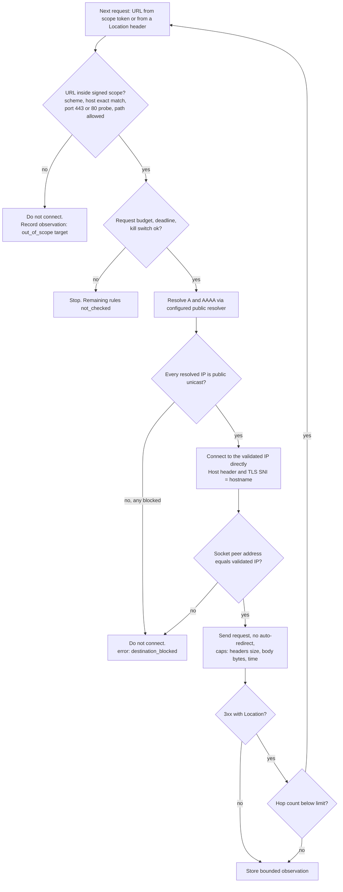

**Blocked destination set** (both in the scanner code *and* in the network egress policy): `0.0.0.0/8`, `10.0.0.0/8`, `100.64.0.0/10`, `127.0.0.0/8`, `169.254.0.0/16` (incl. `169.254.169.254` metadata), `172.16.0.0/12`, `192.0.0.0/24`, `192.0.2.0/24`, `192.168.0.0/16`, `198.18.0.0/15`, `198.51.100.0/24`, `203.0.113.0/24`, `224.0.0.0/4`, `240.0.0.0/4`, `255.255.255.255`; IPv6 `::/128`, `::1/128`, `::ffff:0:0/96` (checked by the embedded IPv4), `64:ff9b::/96` (NAT64, checked by embedded IPv4), `2002::/16` (6to4, embedded IPv4), `2001::/32` (Teredo), `fc00::/7`, `fe80::/10`, `ff00::/8`, `2001:db8::/32`, `fd00:ec2::254`. The list lives in one module with tests for each range (06.2).

| Threat | Control |
|---|---|
| **SSRF to internal services** | Scanner has no route to Z2 (network policy) **and** blocks private/reserved ranges in code; it holds only scan-broker credentials, which give no access to core data (§9.4); API never fetches user URLs |
| **DNS rebinding / TOCTOU** | Resolve once per connection, validate all A/AAAA, connect to the *validated IP* (pinning), verify the socket peer address; never re-resolve between check and connect |
| **Unsafe redirects** | No automatic redirect following. Each `Location` is parsed, resolved relative to the current URL, and run through the full guard. Out-of-scope → recorded, not fetched. Max hops *(RoE, e.g., 5)* |
| **Proxy env hijack** | HTTP client created with proxy support disabled (`trust_env` off); proxy env vars stripped from the scanner container |
| **CNAME to internal names** | Validation happens on final resolved IPs, so a CNAME pointing to an internal address is blocked; scanner uses a public resolver, not the cloud internal resolver |
| **IP-literal / odd host forms** | Project hosts must be DNS names; normalizer rejects IP literals, decimal/octal/hex IPv4 forms, userinfo (`user@host`), and non-default ports |
| **Unauthorized scanning** | Scope token signature + exp + exact host/port/path; verification freshness re-checked at dispatch; kill switch checked before every request; per-target request budget and concurrency 1 *(RoE)* |
| **Hostile responses** | Size and time caps, header count caps, TLS handshake timeout, no decompression bombs (bounded decoder), no JS, no HTML rendering; results JSON-Schema-validated by the worker |
| **Queue abuse** | Per-org rate limits and quotas at the API; idempotency keys; one running scan per project; job deadlines |
| **Scanner compromise** | Read-only filesystem, non-root, dropped capabilities, CPU/memory limits; holds only scan-broker ACL credentials + public verification keys; short-lived instances. Residual capabilities and the network-vs-token guarantee split: §9.4 |

### 9.3 Architecture question — HTTP→HTTPS redirect check inside scope (revised v0.2)

**Correction from v0.1:** v0.1 reported a redirect to an *unverified* host (e.g., `https://www.example.com`) as `pass`. That is withdrawn. The rule's question is about reaching an **authorized** HTTPS destination, and we can't confirm that for a host we may not touch. We now keep two separate things:

| Item | Question it answers | Scored? | Can open/resolve findings? |
|---|---|---|---|
| **Rule `transport.https_redirect`** | "Is plain-HTTP access to this authorized host upgraded to HTTPS on an **authorized** host?" | Yes (Core) | Yes |
| **Observation `obs.http_first_hop`** (informational) | "What did the first HTTP response say?": status, `Location` scheme/host, and whether that target is in scope | No | No |

Any claim about the *final destination* (its TLS, headers, HSTS) comes **only** from requests the scanner was allowed to make to authorized hosts. A `Location` header pointing to an unauthorized host is recorded as text. It is **never requested**.

**Procedure**
1. The scope's `http_redirect_probe: true` allows `GET http://<host>:80/` for each authorized host, plus same-host port-80 redirect hops within the hop limit *(RoE)*.
2. Every hop passes the full egress guard (§9.2), with no automatic following.
3. A `Location` target is followed **only if** it is inside the signed scope: an authorized host of this project, on port 443 (HTTPS) or same-host port 80 (HTTP). Otherwise the chain stops right there.
4. "Connection refused" counts only if it's seen on **every** validated address of the host, and again on a second attempt after a short delay *(RoE)*.

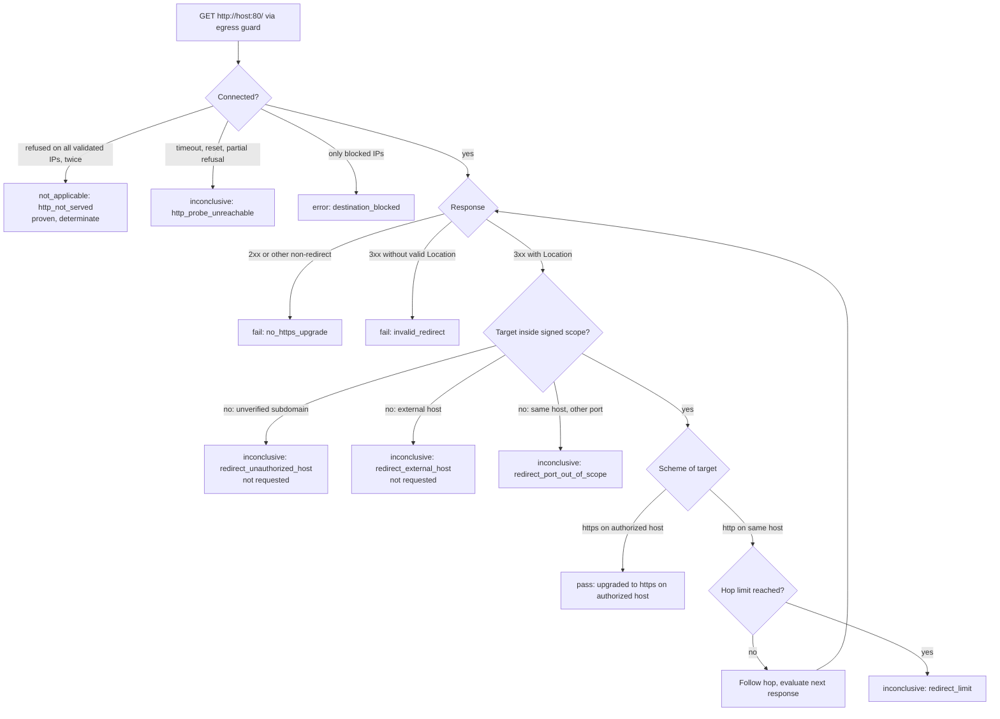

**Precise outcomes**

| Case | Example | Requested? | Rule outcome | Coverage | Lifecycle effect |
|---|---|---|---|---|---|
| Same-host HTTPS upgrade | `http://a.com` → `https://a.com/` | Not needed (the HTTPS entry fetch is separate) | `pass` | determinate | may resolve (confirmed pass) |
| Same-host HTTP hop, then upgrade | `http://a.com` → `http://a.com/home` → `https://a.com/home` | Yes, same host :80, within hop limit | `pass` | determinate | may resolve |
| Upgrade to another **authorized** host | `http://a.com` → `https://www.a.com/`, with `www.a.com` verified and authorized in this project | Allowed | `pass` (evidence: chain + authorized host) | determinate | may resolve |
| Upgrade to **unverified subdomain** | → `https://www.a.com/`, not authorized | **No** | `inconclusive` `redirect_unauthorized_host`; `obs.http_first_hop` records "first hop upgrades to https" | not determinate → scan `partial`, no score | none |
| **External host** | → `https://login.other.com/` | **No** | `inconclusive` `redirect_external_host` | partial | none |
| HTTP-only redirect, cross-host | → `http://www.a.com/` | **No** | `inconclusive` `redirect_unauthorized_host` | partial | none |
| HTTP-only, same host, never upgrades | ends in `200` over http within hop limit | Yes | `fail` `no_https_upgrade` | determinate | opens / reopens |
| Served over HTTP directly | `200` on first request | — | `fail` `no_https_upgrade` | determinate | opens / reopens |
| 3xx without or with unparseable `Location` | — | — | `fail` `invalid_redirect` | determinate | opens / reopens |
| HTTPS on a non-authorized port | → `https://a.com:8443/` | **No** | `inconclusive` `redirect_port_out_of_scope` | partial | none |
| Hop limit exceeded or loop | — | Stopped | `inconclusive` `redirect_limit` | partial | none |
| Connection refused on all validated IPs, confirmed twice | — | — | `not_applicable` `http_not_served` (proven) | determinate | may resolve (`no_longer_applicable`, §10.3) |
| Timeout, reset, or refusal on only some IPs | — | — | `inconclusive` `http_probe_unreachable` | partial | none |
| Host resolves only to blocked IPs | — | — | `error` `destination_blocked` | partial / failed | none |

**Consequences**
- Sites that redirect the apex to `www` (very common) get `partial` and no score until `www` is verified and authorized. The UI offers "Add www.a.com to this project" and explains why. That's a deliberate honesty cost (AR-05).
- Port 80 being *filtered* (timeouts) and port 80 being *closed* (refused) are different. Only "closed" proves HTTP isn't served.
- These outcomes are frozen as fixtures in 07.1/07.2, one fixture per row.

### 9.4 Scanner credentials, reachability and compromise analysis (new in v0.2)

**Correction from v0.1:** the scanner is not "credential-less". It holds a small, limited set of credentials:

| Held by the scanner | Purpose | Power |
|---|---|---|
| Scan-broker ACL username + password, and the broker's TLS CA | Consume jobs, publish results, read cancel/kill flags | Limited to the ACL below |
| Scope-token **public** key set (`kid` → key) | Verify job signatures | None (public material) |
| Resolver address, limits, User-Agent | Configuration | None |

**Not held:** Postgres credentials, Redis-core credentials, Supabase keys, AI/email keys, the scope-token **private** key, any cloud IAM role or workload identity (the metadata endpoint is blocked anyway).

**Broker protocol (refines ADR-0006).** The scanner side does **not** run Celery. Celery/kombu needs broad key patterns and commands that a tight ACL can't express. Instead, the scanner is a minimal **Redis Streams** consumer. The core worker bridges between Celery and the streams.

| Key | Type | Written by | Read by |
|---|---|---|---|
| `scan:jobs` | Stream, consumer group `scanners` | Core worker (`XADD`) | Scanner (`XREADGROUP`, `XACK`, `XAUTOCLAIM`) |
| `scan:results` | Stream | Scanner (`XADD`) | Core worker |
| `scan:cancel:{scan_id}` | String flag with TTL | Core worker | Scanner (read-only) |
| `scan:kill` | Global flag | Core worker / ops | Scanner (read-only) |

**Minimum ACL** (Redis ≥ 7 selectors; the exact command list is verified with tests in 06.1):

```
ACL SETUSER scanner on #<sha256-of-password> resetkeys resetchannels -@all +hello +ping
    (~scan:jobs +xreadgroup +xack +xautoclaim)
    (%W~scan:results +xadd)
    (%R~scan:cancel:* %R~scan:kill +get +exists)
```

The scanner can't run `KEYS`, `SCAN`, `DEL`, `XDEL`, `FLUSH*`, `CONFIG`, `ACL`, `EVAL`, `SUBSCRIBE`, `CLIENT`, `INFO`, or `MONITOR`. It can't write the cancel/kill flags, and it can't read `scan:results`. The `core` user has read/write on `scan:*` with no admin commands. A separate ops/admin user is never deployed with any service.

**Network reachability**

| From scanner to | Allowed |
|---|---|
| `redis-scan` (TLS port) | Yes, the only private destination |
| Configured public DNS resolver, port 53 | Yes |
| Public unicast IPv4/IPv6, TCP 80/443 | Yes (network policy cannot know the scope) |
| Postgres, Redis-core, API, worker, metadata, any private range | **No**, enforced at network level |

`redis-scan` accepts connections only from the scanner and core-worker workloads. Streams are trimmed (`MAXLEN`), and the core worker deletes consumed results.

**Rotation**
- The broker password comes from the secret store at container start. Redis ACL allows two passwords per user: add the new one, roll the scanners, remove the old one. Zero downtime.
- Scheduled rotation (e.g., every 30 days, set in 00.3), plus **immediate** rotation on suspected compromise.
- Scanner instances are short-lived: recycled after N jobs or H hours *(RoE)*.
- Scope-token keys rotate via `kid`: the new public key ships to scanners before the core starts signing with it. The old key is removed after the maximum token TTL.

**What a compromised scanner could still do**

| Capability | Possible? | Why / mitigation |
|---|---|---|
| Reach Postgres, Redis-core, API, metadata, private networks | **No** | Network policy, independent of scanner code |
| Steal application secrets | **No** | They aren't present |
| Forge or widen scope tokens | **No** | No private key |
| Change cancel/kill flags | **No** | Read-only ACL on those keys |
| Read queued jobs (target hosts, org/project UUIDs, scope tokens) | Yes | Jobs carry no customer secrets. Tokens only authorize scanner behaviour. |
| Drop or claim jobs (deny scans) | Yes | Deadlines → `failed` `scanner.unavailable`; alert on "acked without result" |
| Publish **falsified results** for scans it can see | Yes | Core accepts results only for scans in `running` state with a matching job nonce, one result per scan, schema- and size-validated. A compromised observer *can* still lie. Residual risk (R-RES-02): reduced by short-lived instances and partly detectable through anomaly checks. *Erratum E-01 (2026-10-14): signed/pinned image digests prevent wrong-image deployment but do **not** authenticate scanner observations or prevent runtime result fabrication (THREAT_MODEL §4.5).* |
| Send traffic to **arbitrary public hosts** (abuse our IPs as a proxy or scanner) | **Yes** | Network policy only knows "public IP, port 80/443". Scope is enforced in scanner code. Mitigations: network-level rate and bandwidth caps, egress through a monitored NAT with flow logs, autoscaling caps, a kill switch that scales scanners to zero, and an optional scope-enforcing egress proxy outside the scanner (OAD-13). |

**Two different guarantees, never to be confused**

| Property | Network isolation | Signed scope token |
|---|---|---|
| Enforced by | Infrastructure (firewall / network policy), outside the scanner process | Scanner code (signature check + per-request scope check) |
| Still holds if scanner code is compromised | **Yes** | **No** |
| Stops access to internal/private/metadata destinations | **Yes** | — |
| Stops requests to unauthorized **public** hosts | **No** | **Yes**, while scanner code is intact |
| Stops forged jobs injected via a compromised broker | No | **Yes** |
| Stops widening scope (extra hosts, ports, paths) | No | **Yes** |

In short, **network isolation protects VulnScope's infrastructure. Scope tokens protect third parties** from bugs, mistakes, and broker compromise. Neither alone protects third parties from a fully compromised scanner. That residual risk is handled by caps, monitoring, the kill switch, short-lived instances, and the independent review before external beta (13.4).

## 10. From observations to deterministic findings

### 10.1 Pipeline

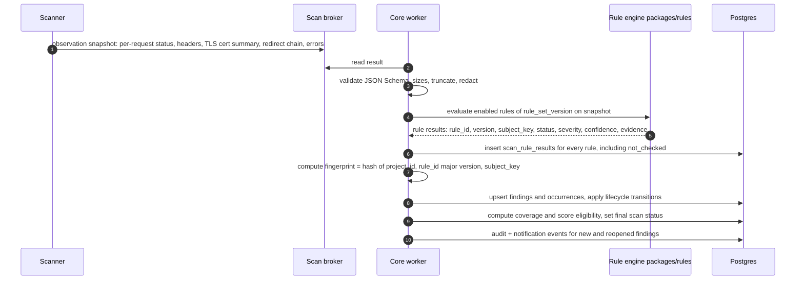

- **Rules are pure functions**: `evaluate(snapshot, rule_config) → RuleResult`. No network, no clock (scan time is passed in), no randomness → same snapshot, same result. This is what makes findings *deterministic* and testable against fixtures.
- **Rule result outcomes** (revised v0.2). Results are produced **per subject**. Coverage is judged **per rule** (§11).

| Outcome | Meaning | Counts toward rule-level coverage | Can resolve an existing finding? |
|---|---|---|---|
| `pass` — **confirmed pass** | The subject was observed completely, and the checked condition is compliant | Determinate | **Yes** (`confirmed_pass`) |
| `fail` | The subject was observed, and the condition is non-compliant | Determinate | — (opens / reopens) |
| `not_applicable` — **proven no longer applicable** | Deterministic evidence shows the rule's precondition doesn't exist, with a coded reason (e.g., `http_not_served`) | Determinate | **Only if** the rule lists that reason in `resolving_na_reasons` (`no_longer_applicable`) |
| `subject_absent` | The rule ran on a complete observation, but this specific subject wasn't present (e.g., cookie `sid` not set this time) | Doesn't affect rule-level coverage | **No** — absence is not a fix |
| `inconclusive` | Ran but couldn't decide (out-of-scope redirect, truncated observation, non-HTML document) | Not determinate | No |
| `not_checked` | Didn't run (budget, deadline, cancelled, dependency failed, preview-only) | Not determinate | No |
| `error` | Collector or rule error | Not determinate | No |

  Rule-level determinacy: a rule is determinate for the scan when it produced a determinate outcome for every subject it could enumerate from a **complete** observation. Example: the cookie rule with zero cookies on complete responses is rule-level `not_applicable` (`no_cookies_observed`), so the rule is determinate. An older open finding for cookie `sid` still gets `subject_absent` and stays open.
- **Subject key** identifies *what* the result is about: host for transport/TLS rules, host + path for document-header rules, host + cookie name for cookie rules. Evidence values (e.g., certificate serial) are not part of the fingerprint, so renewing a cert does not create a "new" finding.
- **Evidence** is bounded and sanitized: header names/values truncated, cookie **names only**, certificate subject/issuer/validity dates, never bodies.

### 10.2 Finding lifecycle and re-scans

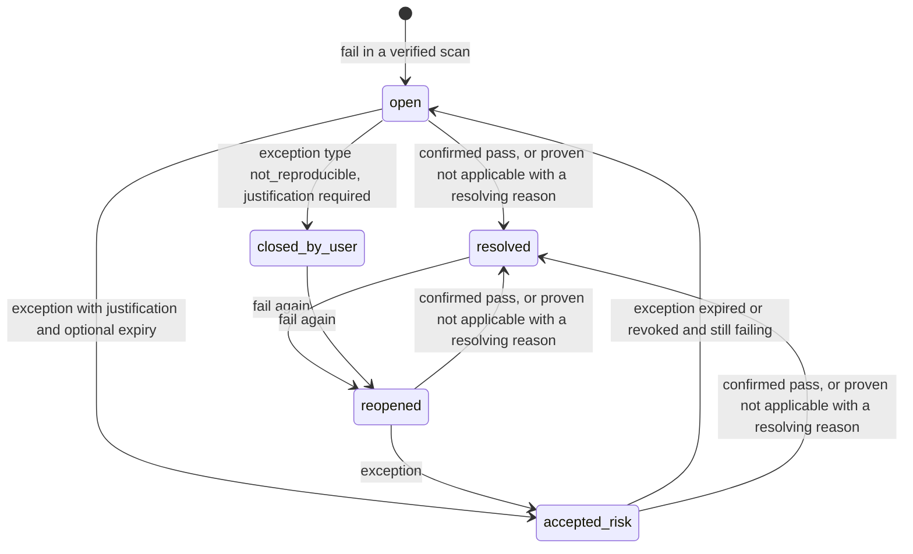

Transition rules per re-scan. Only **verified cloud scans** drive them, never AI and never extension data (revised v0.2):

| This scan's outcome for the fingerprint | Current state | New state | Recorded as |
|---|---|---|---|
| `fail` | none | `open` | first_seen = this scan |
| `fail` | open / reopened / accepted_risk | unchanged | `last_seen` updated, occurrence row |
| `fail` | resolved / closed_by_user | `reopened` | occurrence row, history entry |
| `pass` (confirmed pass) | open / reopened / accepted_risk | `resolved` | `resolution_reason = confirmed_pass`, `resolved_in_scan`, evidence ref |
| `not_applicable` **with a reason in the rule's `resolving_na_reasons`** | open / reopened / accepted_risk | `resolved` | `resolution_reason = no_longer_applicable`, reason code, evidence ref |
| `not_applicable` with any other reason | any | **unchanged** | "Not applicable in scan X (reason)" |
| `subject_absent` | any | **unchanged** | "Not observed in scan X". After K consecutive complete scans, the UI shows a "Not observed since …" hint. **No automatic resolution.** |
| `inconclusive` / `not_checked` / `error` | any | **unchanged** | "Not determinable in scan X (reason)" |

A finding resolves only when **all** of these hold:
1. The scan is a verified cloud scan with status `completed` or `partial`.
2. The outcome is for the **same fingerprint** (same rule major version and subject key).
3. The outcome is `pass`, or `not_applicable` with a resolving reason declared by that rule.
4. The observation for that subject was **complete**, not truncated by caps.
5. Bounded evidence for the resolving outcome is stored and linked from the finding history.

`closed_by_user` is a user decision, shown as "Closed by user", never as "Resolved". It's excluded from "fixed" metrics, needs `findings:manage_exceptions` and a justification, and is audited.

### 10.3 Rule-specific resolution semantics (Core v1)

| Rule | Subject key | Resolves on `pass` when | Resolving `not_applicable` reasons | Never resolves on |
|---|---|---|---|---|
| `transport.https_redirect` | host | Upgrade to HTTPS on an **authorized** host is observed (§9.3) | `http_not_served` (refused on all validated IPs, confirmed twice) | Timeouts, unauthorized/external redirects, hop limit, blocked destination |
| `tls.certificate` | host:443 | Chain trusted, hostname matches, not expired, outside the expiry warning window | none | Handshake timeout, TLS errors unrelated to the certificate (`inconclusive`) |
| `headers.hsts` | host (final in-scope HTTPS response) | Valid header with `max-age` ≥ threshold *(07.2)* | none | Final response out of scope, unusable status (`inconclusive`) |
| `headers.csp_presence` | host + path (in-scope HTML document) | Enforcing `Content-Security-Policy` header present | none (a non-HTML response is `inconclusive`, not `not_applicable`) | Report-only policy alone (that's a lower-severity `fail`) |
| `headers.x_content_type_options` | host + path | `nosniff` present | none | — |
| `headers.referrer_policy` | host + path | Present with an accepted value | none | — |
| `cookies.flags` | host + cookie name | That cookie is observed with **all** required flags (`Secure`, `HttpOnly` where applicable, `SameSite`). A partial fix keeps the finding open with updated evidence. | none | `subject_absent` (cookie not set this time), truncated `Set-Cookie` headers |

Each rule declares `resolving_na_reasons` in its definition. The default is an **empty** list. Adding a reason is a rule version change and goes through the quality gate (§12).

### 10.4 Lifecycle acceptance criteria (carried into the 00.4 backlog)

| ID | Given / When / Then |
|---|---|
| AC-LC-01 | Given an open finding, when a verified scan yields `pass` for the same fingerprint from a complete observation, then it becomes `resolved` with `confirmed_pass` and an evidence link |
| AC-LC-02 | Given an open `transport.https_redirect` finding, when port 80 is refused on all validated IPs on two attempts, then it becomes `resolved` with `no_longer_applicable` / `http_not_served` |
| AC-LC-03 | Given an open `cookies.flags` finding for `sid`, when `sid` is not set in a complete scan, then the state is unchanged and the occurrence records `subject_absent` |
| AC-LC-04 | Given any open finding, when the outcome is `inconclusive`, `not_checked` or `error`, then the state is unchanged |
| AC-LC-05 | Given an open finding, when the outcome is `not_applicable` with a reason **not** in `resolving_na_reasons`, then the state is unchanged |
| AC-LC-06 | Given an open finding, when an extension observation is synced or an AI explanation says "fixed", then the state is unchanged (the findings module has no code path from either) |
| AC-LC-07 | Given a resolved or closed_by_user finding, when a later verified scan yields `fail`, then it becomes `reopened` and history is preserved |
| AC-LC-08 | Given a rule major-version change, then no cross-version resolution happens; findings are mapped by declared migration or marked `superseded` |
| AC-LC-09 | Given a `pass` computed from a truncated observation, then the rule returns `inconclusive` instead, and nothing resolves |
| AC-LC-10 | Every state transition writes a history/audit entry with scan id, outcome, reason code and evidence reference |
| AC-LC-11 | Given an unverified-subdomain redirect, then `transport.https_redirect` is `inconclusive` and no request is sent to that host (asserted by fixture server logs) |

**Lifecycle notes**
- Partial scans **can** open and resolve findings, but only through outcomes that meet the resolution conditions above.
- A rule **major** version change starts a new fingerprint namespace; the worker maps old → new where the rule declares a migration, otherwise old findings are closed as `superseded` with a note.
- **Scan comparison** (08.4) is a diff of two scans' `scan_rule_results` by fingerprint: new / fixed / unchanged / reopened / not-checked-in-one. It is computed from stored data, never re-evaluated.

## 11. Architecture question — incomplete coverage and posture-score eligibility

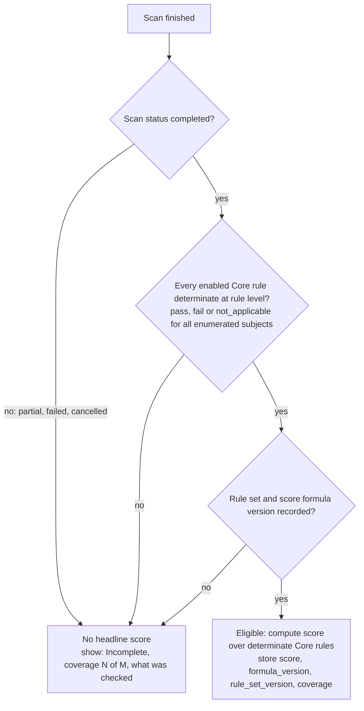

- **Eligibility is binary and strict in MVP**: 100% of enabled Core rules determinate *and* scan `completed`. There is no "80% coverage is good enough" threshold, because a threshold would let a scan that couldn't check TLS still show a good number (DEC-011).
- `scan.status = completed` is *defined* as "all enabled Core rules determinate", so the two conditions agree by construction; the second check guards against bugs.
- **Tier 2 / preview rules** never affect eligibility or score; they appear as a separate "Additional observations" section.
- `not_applicable` counts as determinate but is excluded from the score's denominator.
- Score changes across `formula_version` or `rule_set_version` are flagged in comparison, not shown as improvement/regression.
- Accepted-risk effect on score: open decision OAD-06.

### 11.1 Current vs historical score (revised v0.2)

**Correction from v0.1:** v0.1 put "last complete score X" right next to "latest scan incomplete", which could read as a current score. In v0.2, a **current score exists only when the latest finished scan is eligible**. Anything older is *historical* and is presented as history, never as the current state.

**API shape (no fallback field):**

```
current_score:    null | { value, scan_id, completed_at, coverage, formula_version, rule_set_version }
historical_score: null | { value, scan_id, completed_at, coverage, formula_version, rule_set_version,
                            superseded_by_scan_id, superseded_reason }
```

There is no single `score` field that silently falls back to an older value. `current_score` is non-null **only if** the latest finished scan (any status) is eligible.

**Display rules**

| Situation | Headline area | Historical score |
|---|---|---|
| Latest scan eligible | Current score + coverage + timestamp + "Based only on passive checks VulnScope ran. Not a guarantee of security." | — |
| Latest scan `partial` / `failed` / `cancelled` | **"Latest scan incomplete — no current score"** + that scan's coverage, status and timestamp. No number, ring, gauge or grade color. | Allowed only in a separate, visually subordinate **"History"** element labeled **"Historical — previous complete scan"**, with its **original scan timestamp**, its **coverage**, rule-set version and age ("23 days old"). Muted style, no ring/gauge, no grade color, never the largest number on screen. |
| Rule set or formula changed since the historical scan | as above | Extra label: "Rules have changed since this score" |
| Verification or authorization lapsed or revoked | "Scanning suspended — ownership or authorization not active" | Shown **only** inside the project's scan history, not on the overview |
| No eligible scan ever | "No complete scan yet" | — |

Everywhere else:
- **Project lists, dashboards, sorting:** use `current_score` only. Projects without one show "—" with the status text, and sort last. They're never ranked by a historical value.
- **Reports** for an incomplete scan never print a score in the summary. A history table may list earlier eligible scores, each with its own date and coverage.
- **Notifications and alerts** never mention a score.
- **Extension:** shows the dashboard's `current_score` state only, never a historical one.

Acceptance criteria (into 00.4): **AC-SC-01** an incomplete latest scan ⇒ `current_score = null` and no numeric score in the headline. **AC-SC-02** a historical score always renders with its own timestamp, coverage and the "Historical" label. **AC-SC-03** list views never display or sort by `historical_score`.

## 12. Architecture question — measuring rule quality before enabling

Rules move through a lifecycle stored in `rule_definitions`:

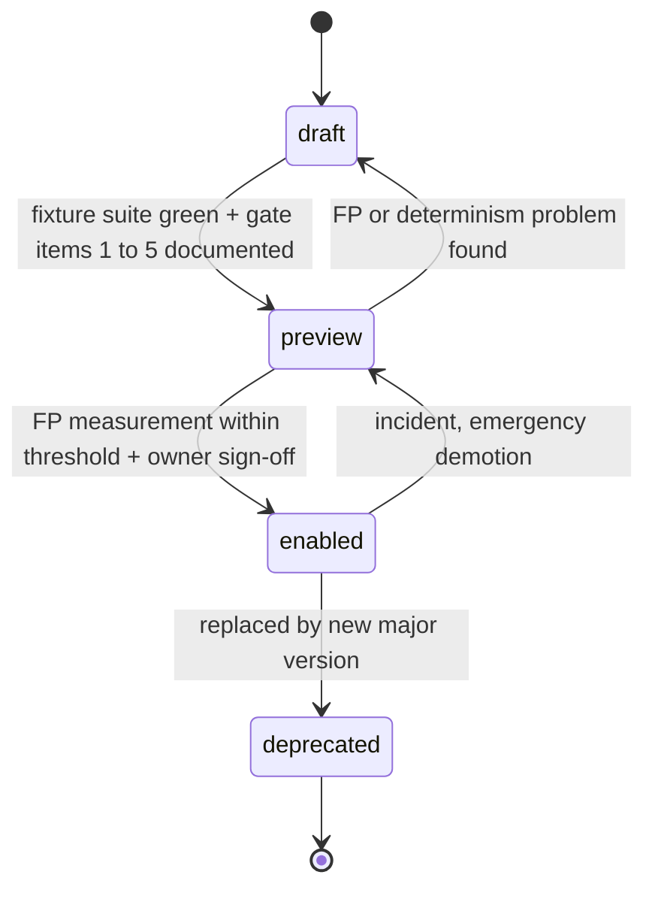

| Measure | How | Gate |
|---|---|---|
| **Correctness on fixtures** | `infra/fixtures`: local HTTP/TLS servers (valid, expired, self-signed, wrong-host certs; header variants; redirect chains; cookie variants). Each fixture has an expected result per rule. Runs in CI with **no external network**. | 100% expected outcomes |
| **Determinism** | Evaluate each fixture snapshot twice and across a snapshot round-trip (serialize → deserialize) → identical results and fingerprints | 100% identical |
| **Unknown handling** | Fixtures that remove inputs (timeouts, truncated headers) must yield `inconclusive`/`not_checked`, never `pass` | 100% |
| **False-positive rate (preview)** | In `preview`, the rule runs inside real verified scans but its results are stored with `preview=true`: not shown as findings, not scored. The owner reviews a sample of preview results on owner-authorized sites and labels them TP/FP/unclear. **FP rate = confirmed FP ÷ labeled fail results.** | Threshold OD-03 (proposed: 0 confirmed FPs over ≥ N labeled results) |
| **User signal (enabled)** | "Report false positive" on findings → stored, triaged; rule FP rate dashboard per rule version | Above threshold → demote to preview |
| **Change control** | Any change to rule logic = new rule version + re-run fixtures + preview again if the major version changes | Recorded in `rule_definitions.gate_evidence` |

## 13. Data-source trust levels in the architecture

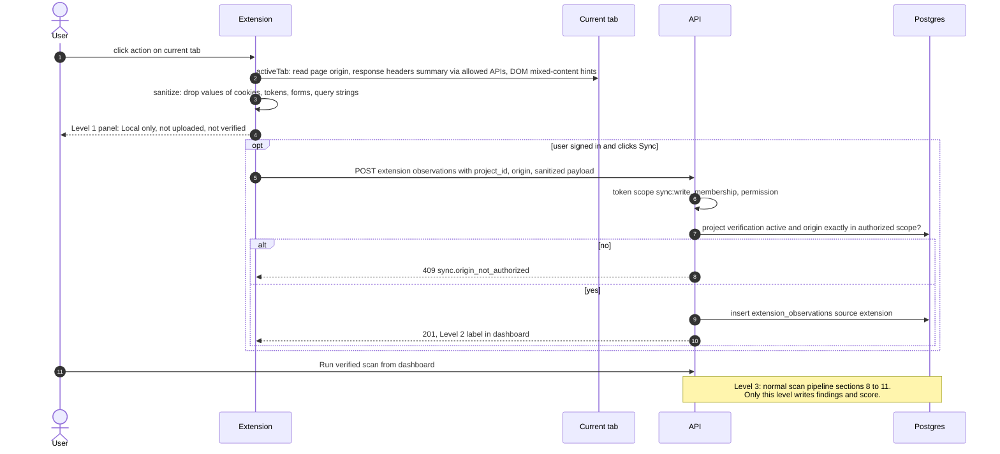

Architectural enforcement of the three levels:

| Control | Level 1 Local | Level 2 Synced | Level 3 Verified scan |
|---|---|---|---|
| Storage | `chrome.storage.session` / memory, TTL (OD-02) | `extension_observations` table | `scan_jobs`, `scan_rule_results`, `findings`, `finding_occurrences` |
| Written by | Extension | API extension module only | Core worker only |
| Code path to findings | None | **None** — the findings module has no dependency on `extension_observations` | Yes |
| In score | No | No | Yes (§11) |
| UI label | "Local only" | "Extension observation · from your browser · date" | Scan ID, coverage, status |

Extension auth design (details in 10.3): extension opens the web app's `/extension/connect` page via `chrome.identity.launchWebAuthFlow`; the signed-in user approves; the API issues an **opaque, scoped, short-lived extension token** (hashed at rest, refresh-rotated, revocable from the dashboard). The extension never holds a Supabase refresh token. Alternatives in OAD-02.

## 14. AI assistant data flow

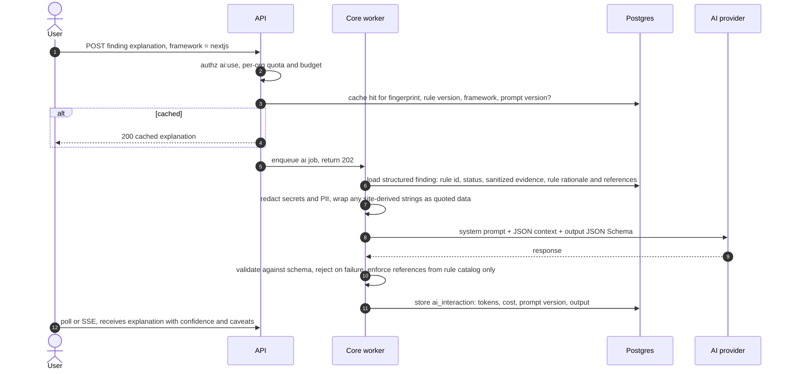

- Input is **only** stored structured data + user-chosen framework; no live page content, no full headers beyond the sanitized evidence.
- Site-derived strings (e.g., a `Server` header value) are delimited and labeled as untrusted data; the prompt instructs the model to treat them as data only. Output is validated, rendered as escaped text + a restricted Markdown subset; code snippets shown as text, never executed.
- The AI cannot call tools, change findings, or trigger scans. "Fixed" only comes from §10 (FR-08).
- Provider adapter interface: `generate(structured_input, schema, budget) → validated_output`; provider and model from environment (09.1, OD-04).

## 15. Reports, monitoring, notifications (overview)

- **Reports** (11.3): worker renders an English HTML template (auto-escaped, locale-parameterized for future Arabic) → PDF in a sandboxed renderer with network disabled; JSON export from the same data model. Content: scope, method, timestamps, coverage, status, score caveat, limitations, disclaimer, optional labeled appendix of synced extension observations.
- **Monitoring** (11.1): Celery beat schedules per opted-in project → revalidation probe first → scan only if verification fresh → alerts on new/reopened fingerprints only (deduplicated by fingerprint + state) → email adapter with per-org caps and one-click disable.

## 16. Data protection

- **Secrets**: environment variables / platform secret store; `.env.example` only with placeholders; never in DB, logs, browser storage, prompts, or reports. Signing private key (scope tokens) only in the core worker; scanner gets the public key.
- **Logging**: structured JSON with request/correlation IDs; a redaction filter removes `Authorization`, cookies, tokens, challenge tokens, emails where not needed.
- **Retention**: no response bodies stored; evidence bounded; retention windows for scan evidence, AI interactions, extension observations, audit events defined in 00.3/12.4; deletion jobs in the worker.

## 17. Failure handling — fail closed

| Failure | Behavior |
|---|---|
| JWKS unreachable | Use cached keys until cache TTL; then 503, never skip verification |
| Postgres unavailable | API 503; jobs retried with backoff; no partial writes (transactions per scan result) |
| Redis core down | Enqueue fails with 503 `jobs.unavailable`; nothing is "pretend queued" |
| Scan broker down / scanner gone | Job stays `queued` until deadline → `failed` with `scanner.unavailable` |
| Scope token invalid/expired | Scanner rejects job → `failed` `scope.invalid` + security log |
| Egress guard error | Treated as blocked; rule results `error`; scan `partial`/`failed` |
| Result schema invalid | Discard, scan `failed` `result.invalid`, alert |
| AI provider error/over budget | 503/429 with clear UI state; findings unaffected |
| Kill switch on | API refuses new scans; scanner aborts before next request; running scans → `cancelled` |
| Supabase Admin API down during invite redemption | Invite returns to `pending` (fenced by attempt id) or is reconciled later; user sees "try again later"; no identity is created outside the flow |
| Verification active but authorization missing/stale | Scan refused with `scan.authorization_required`; UI shows the consent screen with a scope diff |

## 18. Risks and trade-offs

| ID | Decision / risk | Trade-off | Mitigation |
|---|---|---|---|
| AR-01 | Modular monolith instead of microservices | Single API deploy is a larger blast radius | Strong module boundaries, the scanner (the risky part) *is* separated |
| AR-02 | Two Redis instances | More infra to run | Required so the scanner cannot touch core queues/cache; cheap locally |
| AR-03 | Rules evaluated in worker, not scanner | Larger result payloads cross TB-4 | Strict schema + size caps; keeps the hostile-input zone minimal |
| AR-04 | Bearer JWT readable by JS | XSS would expose a short-lived token | Strict CSP, escaped rendering, short JWT TTL, BFF alternative recorded |
| AR-05 | Strict score eligibility + no `pass` for unauthorized redirects + port-80 timeouts are inconclusive | Many real scans may show "Incomplete" (apex→`www` redirects, filtered port 80) | Clear UX guidance to verify missing hosts; explains *why*; measure in beta how often it happens |
| AR-06 | No headless browser in MVP | Mixed-content detection limited to static HTML hints | Labeled as limitation; reconsider post-MVP |
| AR-07 | Local network isolation is approximate | Local dev doesn't prove production egress policy | External scanning disabled locally/CI; production egress validated independently before beta (13.4) |
| AR-08 | Supabase dependency | Vendor outage blocks login | JWKS cache, auth adapter, identity mirrored in our tables |
| AR-09 | Celery complexity | Heavier than simpler queues | Mature cancellation/time limits/retries/beat; alternative recorded (OAD-04) |
| AR-10 | Compromised scanner can send traffic to arbitrary **public** hosts and falsify results | Network policy cannot express per-scan scope | Rate/bandwidth caps, monitored NAT + flow logs, short-lived instances, kill switch to zero, result fencing; optional scope-enforcing egress proxy (OAD-13); independent review (13.4). *Erratum E-02 (2026-10-15): signed/pinned scanner images are deployment-integrity (wrong-image) controls only; they are **not** a defense against runtime observation fabrication by compromised scanner code (THREAT_MODEL §4.5).* |
| AR-11 | Invite flow depends on Supabase admin API + disabled public sign-up | Provider behaviour change could reopen sign-up | Negative tests for every enabled auth method in CI against local Supabase; bootstrap backstop; orphan-identity reconciler |
| AR-12 | Two custom pieces (Streams consumer, invite reconciler) instead of library defaults | More code to own | Small, well-tested, needed for tight ACL and atomic invites |
| AR-13 | `subject_absent` never auto-resolves | Some fixed findings (e.g., removed cookies) stay open | "Not observed since" hint + `closed_by_user` with justification |

## 19. Open architectural decisions

| ID | Question | Alternatives | Recommendation | Needed by |
|---|---|---|---|---|
| OAD-01 | Postgres Row-Level Security in addition to app-level isolation? | A) App-level only · B) RLS on all tenant tables · C) RLS on high-value tables | **B**, if the integration test cost stays low; decide with the ERD | 00.4 / 04.2 |
| OAD-02 | Extension authentication | A) launchWebAuthFlow + our scoped extension token · B) Supabase session inside the extension · C) Device-code style pairing | **A** | 10.3 (design in 00.3) |
| OAD-03 | Production container platform | Must support per-service egress rules and private networking: e.g., Google Cloud Run + VPC firewall, AWS ECS/Fargate + security groups, Fly.io, Render, Railway | Shortlist with egress capability verified + cost, decide before 06.2 | 06.2 (latest), 13.3 |
| OAD-04 | Job framework | A) Celery + Redis · B) Dramatiq · C) arq/RQ | **A** (contract default, mature time limits/cancel/beat) | 01.1 |
| OAD-05 | Verification revalidation policy | A) Before every scan · B) If last check older than 24 h · C) Fixed 30-day expiry only | **B** + always before scheduled scans + hard expiry 30 days | 05.3 |
| OAD-06 | Does accepted risk change the score? | A) Still counts as fail · B) Excluded from denominator · C) Counts as pass | **A** (honest), shown with "accepted" tag | 07.5 |
| OAD-07 | Scanner ↔ core transport | A) Dedicated Redis scan broker with a Streams protocol and tight ACL (§9.4) · B) Scanner pulls via narrow HTTPS gateway with signed jobs | **A** for MVP; B if the platform makes private Redis hard or the ACL can't be verified in 06.1 | 06.1 |
| OAD-08 | AI request mode | A) Async job + poll/SSE · B) Synchronous streaming from API | **A** (keeps API without AI egress, budget enforcement in one place) | 09.1 |
| OAD-09 | Python packaging | A) uv workspaces · B) pip-tools · C) Poetry | **A** (fast, lockfile, workspace support) — verify in 01.1 | 01.1 |
| OAD-10 | Mixed-content detection depth | A) Static HTML parse of bounded body · B) Headless browser in scanner | **A** in MVP | 07.4 |
| OAD-11 | Scanner DNS resolver | A) Public resolver (e.g., 1.1.1.1 / 8.8.8.8 / 9.9.9.9) · B) Self-run recursive resolver in scan zone | **A** for MVP, configurable | 06.2 |
| OAD-12 | API exposure for the web app | A) Browser calls API directly with Bearer · B) All calls via Next.js BFF with HttpOnly cookies | **A** + server components use the same token server-side (ADR-0004) | 03.1 |
| OAD-13 | Scope enforcement outside the scanner process | A) None beyond caps/monitoring · B) Scope-enforcing egress proxy in its own zone that checks each connection against the signed scope token (and re-does IP validation) · C) Per-scan dynamic firewall allowlist | **A** for local/early dev; **B** evaluated before external beta (13.4) | 06.2 design, 13.4 decision |
| OAD-14 | Transactional email for Supabase invite/confirmation emails | Custom SMTP provider with a free tier vs paid provider | Free-tier SMTP for beta; cost approval required | 03.1 |
| OAD-15 | Who may re-consent / does consent survive the consenting user's role loss? | A) Authorization stays valid until revoked · B) Auto-suspend when the consenting user loses owner/admin | **B** (safer), confirm in 00.3 | 00.3 |

## 20. ADR index

| ADR | Title | Status |
|---|---|---|
| [0001](adr/0001-modular-monolith.md) | Modular monolith with two worker pools | accepted |
| [0002](adr/0002-monorepo-and-stack.md) | Monorepo layout and core stack | accepted |
| [0003](adr/0003-auth-supabase-jwt.md) | Supabase Auth with server-side JWT verification | accepted |
| [0004](adr/0004-api-access-bearer-tokens.md) | API access via Bearer tokens, no cookie auth on API | accepted |
| [0005](adr/0005-tenant-isolation-rbac.md) | Tenant isolation and RBAC enforcement | accepted |
| [0006](adr/0006-jobs-celery-two-brokers.md) | Celery jobs with separate core and scan brokers | accepted |
| [0007](adr/0007-isolated-scanner-egress.md) | Isolated scanner and egress controls | accepted |
| [0008](adr/0008-verification-via-scanner.md) | Domain verification performed by the scanner | accepted |
| [0009](adr/0009-signed-scope-tokens.md) | Signed scope tokens for scan jobs | accepted |
| [0010](adr/0010-deterministic-rule-engine.md) | Deterministic, versioned rule engine with tiers | accepted |
| [0011](adr/0011-posture-score-eligibility.md) | Strict posture-score eligibility | accepted |
| [0012](adr/0012-extension-trust-levels.md) | Extension data trust levels and auth | accepted |
| [0013](adr/0013-ai-adapter-grounding.md) | Provider-agnostic AI adapter with grounding | accepted |
| [0014](adr/0014-invite-only-registration.md) | Invite-only registration with atomic redemption | accepted |
| [0015](adr/0015-control-vs-authorization.md) | Technical control verification vs authorization to scan | accepted |
