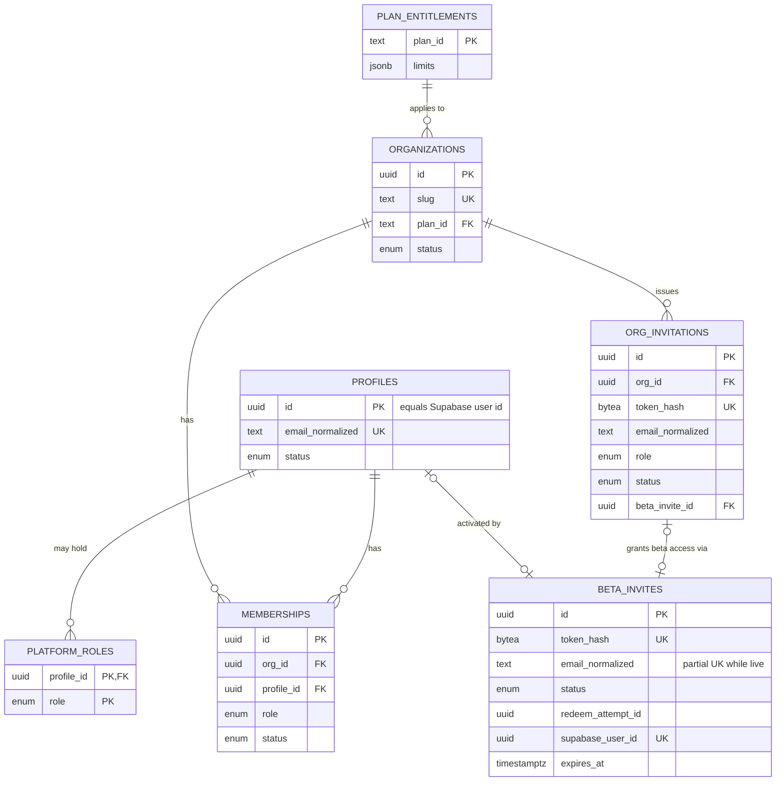
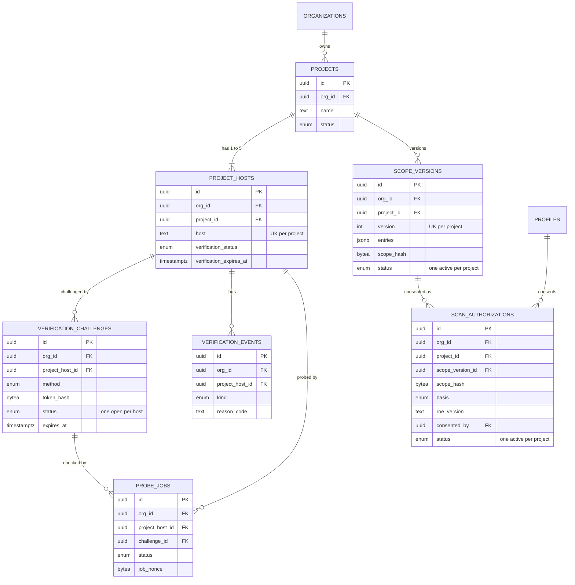
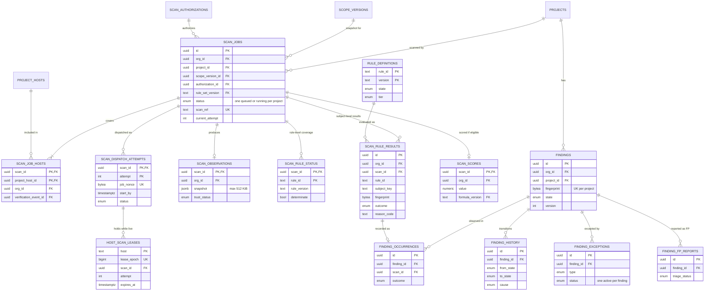
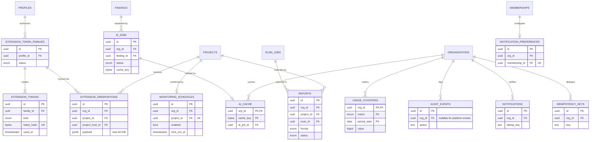

# VulnScope — Data Model

| Field | Value |
|---|---|
| Status | **APPROVED — DESIGN LEVEL v0.3.1 — Task 00.4 (owner approval 2026-10-15, DEC-058)** |
| Date | 2026-10-15 |
| Changelog | **v0.3.1 (post-Phase-00 audit, 2026-10-15):** R-L14 and AC-LOCK-14 aligned with DEC-057 (explicit deadline validation on every delivery; claimed/re-read entries never executed); R-L17, DM-A6 and the clock-skew failure row aligned with DEC-056 (heartbeat = health signal, LG-SCN-12). **v0.3:** §5.1 publish marker committed before any `XADD` (R-L8), single publish path (R-L15), autoclaim rule (R-L14), in-transaction DB-identity guard for failover with dispatch disabled when it can't be proven (R-L12), scanner relative runtime cap (R-L16), clock-skew monitoring and fail-closed pause (R-L17, DM-A6); `scanner_instances` table; AC-LOCK-12…17. **v0.2:** TX-10 rewritten as a PostgreSQL host-lease protocol with fencing epochs (§5.1; Redis removed from the exclusivity path); TX-11 rewritten with an explicit validate → evaluate → lock → re-check → apply order and exactly-once application (§5.2); TX-16 and authorization-affecting TXs serialize on the scan row; new tables `host_scan_leases`, `scan_dispatch_attempts`; new acceptance tests AC-LOCK-01…11, AC-RES-01…10. **v0.1:** initial draft |
| Sources | PRD v0.2 · ARCHITECTURE v0.2 (+E-01) · ADR-0001…0015 · THREAT_MODEL v0.2 · RoE-1 · DECISIONS DEC-001…042 |
| Companions | `API_CONTRACTS.md` · `PERMISSIONS.md` · `TRACEABILITY.md` · `BACKLOG.md` |
| Database | PostgreSQL (version pinned in 01.1). Our app DB only. Supabase Auth runs separately; **no foreign keys into Supabase's schema** |

This is a design, not a migration. Column types are logical (`uuid`, `text`, `timestamptz`, `jsonb`, `bytea`, `int`, `bigint`, `bool`, `numeric`, named enums). Alembic migrations are written phase by phase (BACKLOG.md).

---

## 0. Conventions

| ID | Rule |
|---|---|
| DM-C1 | Primary keys are `uuid` (UUIDv7 generated by the application, for index locality). Public references that appear in URLs or headers are separate opaque values where noted (`scan_ref`). |
| DM-C2 | Every table has `created_at timestamptz NOT NULL DEFAULT now()`. Mutable tables also have `updated_at`. Append-only tables have no `updated_at`. |
| DM-C3 | **Tenant tables** carry `org_id uuid NOT NULL`. Every tenant table has `UNIQUE (org_id, id)`, so children can reference parents with a **composite foreign key `(org_id, parent_id)`**. The database itself then refuses a child whose `org_id` differs from its parent's (cross-tenant linking is impossible, not just unlikely). |
| DM-C4 | **Global tables** (no `org_id`): `profiles`, `beta_invites`, `platform_roles`, `rule_definitions`, `rule_sets`, `rule_set_members`, `score_formulas`, `plan_entitlements`, `host_deny_list`, `platform_controls`, `extension_token_families`, `extension_tokens`, `retention_policies`, `outbox_events` (nullable `org_id`). They're accessed only through services that never return another tenant's data. |
| DM-C5 | Secrets/tokens are stored as `bytea` **hashes** (SHA-256 of a 256-bit random value). Raw values are never stored. |
| DM-C6 | Hostnames are stored **normalized** (lowercase, IDNA/punycode, no trailing dot) in `text` with a `CHECK` on length ≤ 253 and allowed characters. IP literals are rejected by the normalizer (SAC-SSRF-01). |
| DM-C7 | State columns use Postgres enums. Allowed **transitions** are enforced in the service layer (single function per entity) and covered by tests; a DB trigger guard is optional (open item DM-OI-03). |
| DM-C8 | Bounded JSON: every `jsonb` column has a documented schema and a size `CHECK` (`pg_column_size(...) <= N`). |
| DM-C9 | Append-only tables (`*_events`, `finding_history`, `audit_events`, `finding_occurrences`): the app role `vs_app` has `INSERT`/`SELECT` only (SAC-DB-01). |
| DM-C10 | Soft delete only where a lifecycle needs it (`organizations`, `projects`); everything else is deleted by retention jobs (§7). |

## 1. Entity-relationship diagrams

Split into four views for readability. Each shows keys and relationship cardinality; full columns are in §2.

### 1.1 Identity, organizations, invitations

### 1.2 Projects, hosts, verification, scope, authorization

### 1.3 Scans, observations, rule results, findings

### 1.4 Extension, AI, reports, monitoring, usage, audit, platform

Platform tables without relationships drawn: `host_deny_list`, `platform_controls`, `retention_policies`, `outbox_events`, `rule_sets`, `rule_set_members`, `score_formulas`.

## 2. Table catalogue

Notation: **PK**, **FK** (composite `(org_id, x)` where marked ⊕), **UK** unique, **PUK** partial unique, **IX** index, **CK** check. All tenant tables also have `UNIQUE (org_id, id)` (DM-C3), not repeated below.

### 2.1 Identity and access (global)

**profiles** — PK `id` (= Supabase `sub`)
- `email_normalized text` **UK** · `display_name text` (≤ 80) · `status profile_status` (`active`, `disabled`, `deleted`) · `last_seen_at`
- Created only in TX-02 (bootstrap). Never created from an unverified JWT.

**beta_invites** — PK `id` (ARCHITECTURE §7.1, ADR-0014)
- `token_hash bytea` **UK** · `email_normalized text NOT NULL` · `status beta_invite_status` (`pending`, `redeeming`, `provisioned`, `activated`, `expired`, `revoked`, `failed`) · `expires_at` · `created_by uuid` FK profiles (nullable for ops seeding) · `org_invitation_id` FK (nullable) · `redeem_attempt_id uuid` · `redeem_started_at` · `supabase_user_id uuid` **UK** (nullable) · `activated_at` · `failure_reason text`
- **PUK** `(email_normalized) WHERE status IN ('pending','redeeming','provisioned')`
- **IX** `(status, expires_at)`, `(status, redeem_started_at)` for reconciler

**platform_roles** — PK `(profile_id, role)`; `role platform_role` (`platform_admin`). Granted only by migration/ops script, audited.

**extension_token_families** — PK `id` · `profile_id` FK · `status` (`active`, `revoked`) · `device_label text` (≤ 60) · `scopes text[]` (CK ⊆ {`projects:read`,`sync:write`}) · `created_at` · `last_used_at` · `revoked_at` · `revoked_reason` (`user`, `reuse_detected`, `membership_change`, `admin`)
- **IX** `(profile_id, status)`

**extension_tokens** — PK `id` · `family_id` FK · `kind` (`access`, `refresh`) · `token_hash` **UK** · `expires_at` (access 15 min, refresh 7 days) · `used_at` (refresh only) · `revoked_at`
- **IX** `(family_id)`, `(expires_at)` for cleanup

**extension_auth_codes** — PK `id` · `profile_id` · `code_hash` **UK** · `code_challenge text` (S256) · `redirect_uri text` (must equal the extension's `chromiumapp.org` URI) · `expires_at` (≤ 2 min) · `used_at`. One-time PKCE codes for `launchWebAuthFlow` (OAD-02 A, assumed; see §8).

### 2.2 Organizations

**organizations** — PK `id` · `name text` (≤ 80) · `slug text` **UK** · `plan_id` FK plan_entitlements · `status org_status` (`active`, `suspended`, `deleted`) · `created_by` · `deleted_at`

**memberships** ⊕ — PK `id` · `org_id` FK · `profile_id` FK · `role membership_role` (`owner`, `admin`, `analyst`, `viewer`) · `status membership_status` (`active`, `revoked`) · `created_by` · `revoked_at` · `revoked_by` · `revoked_reason`
- **PUK** `(org_id, profile_id) WHERE status='active'`
- **IX** `(profile_id, status)`, `(org_id, role) WHERE status='active'`
- Invariant: ≥ 1 active owner per active org (TX-04).

**org_invitations** ⊕ — PK `id` · `org_id` · `email_normalized` · `role` (CK ≠ `owner`) · `token_hash` **UK** · `status` (`pending`, `accepted`, `expired`, `revoked`) · `expires_at` (7 days) · `invited_by` · `accepted_by` · `beta_invite_id` FK (nullable; set when the invitee has no profile yet)
- **PUK** `(org_id, email_normalized) WHERE status='pending'`

**notification_preferences** ⊕ — PK `id` · `org_id` · `membership_id` **UK** ⊕ · `email_enabled bool` · `events text[]` (CK ⊆ catalogue)

### 2.3 Projects, hosts, verification

**projects** ⊕ — PK `id` · `org_id` · `name` (≤ 80) · `status project_status` (`active`, `archived`) · `created_by` · `archived_at`
- **PUK** `(org_id, lower(name)) WHERE status='active'`

**project_hosts** ⊕ — PK `id` · `org_id` · `project_id` ⊕ · `host text` (DM-C6) · `is_primary bool` · `verification_status` (`unverified`, `verified`, `unknown`, `revoked`) · `verified_at` · `verification_expires_at` (30 days after last success, RoE §12) · `last_check_at` · `last_success_at` · `last_method` · `transient_failures int` · `removed_at`
- **UK** `(project_id, host)`; **PUK** `(project_id) WHERE is_primary`
- **IX** `(host)` (cross-org lookups for the deny list and host-lease diagnostics, §5.1); `(verification_status, verification_expires_at)`
- Max 5 active hosts per project, enforced in TX-05a under a project row lock (RoE §4).

**verification_challenges** ⊕ — PK `id` · `org_id` · `project_host_id` ⊕ · `method` (`dns_txt`, `https_file`) · `token_hash` · `status` (`open`, `consumed`, `superseded`, `expired`) · `expires_at` (72 h) · `created_by`
- **PUK** `(project_host_id) WHERE status='open'`

**verification_events** ⊕ (append-only) — PK `id` · `org_id` · `project_host_id` ⊕ · `challenge_id` (nullable) · `probe_job_id` (nullable) · `kind` (`check_requested`, `succeeded`, `failed_definite`, `failed_transient`, `revoked`, `expired`) · `reason_code` · `actor_id` (nullable for system)
- **IX** `(project_host_id, created_at DESC)`

**probe_jobs** ⊕ — PK `id` · `org_id` · `project_host_id` ⊕ · `challenge_id` (nullable for revalidation) · `purpose` (`verify`, `revalidate`) · `status` (`queued`, `running`, `completed`, `failed`, `cancelled`) · `job_nonce bytea` · `deadline_at` · `result_code` · `requested_by`
- **PUK** `(project_host_id) WHERE status IN ('queued','running')`

### 2.4 Scope and authorization

**scope_versions** ⊕ — PK `id` · `org_id` · `project_id` ⊕ · `version int` · `entries jsonb` (schema S-SCOPE-1: `[{host_id, host, https_port: 443, http_redirect_probe: bool, paths: [..≤5]}]`, CK size ≤ 8 KiB) · `scope_hash bytea` (SHA-256 of canonical JSON) · `status` (`active`, `superseded`) · `created_by`
- **UK** `(project_id, version)`; **PUK** `(project_id) WHERE status='active'`
- Immutable after insert (no `UPDATE` except `status` → `superseded`).

**scan_authorizations** ⊕ — PK `id` · `org_id` · `project_id` ⊕ · `scope_version_id` ⊕ · `scope_hash` · `basis` (`asset_owner`, `written_authorization_from_owner`) · `reference_note text` (≤ 200) · `roe_version text` · `consented_by` FK profiles · `consented_at` · `expires_at` (12 months) · `status` (`active`, `suspended`, `revoked`, `expired`) · `status_reason` (`scope_changed`, `roe_changed`, `consenter_role_lost`, `verification_lapsed`, `abuse_review`, `user_revoked`, `expired`) · `revoked_by`
- **PUK** `(project_id) WHERE status='active'`
- CK `scope_hash` equals the referenced scope version's hash (checked in TX-08).

### 2.5 Scans

**scan_jobs** ⊕ — PK `id` · `org_id` · `project_id` ⊕ · `scope_version_id` ⊕ · `authorization_id` ⊕ · `rule_set_version` FK · `formula_version` FK · `roe_version` · `trigger` (`manual`, `scheduled`) · `initiated_by` (nullable for scheduled) · `status scan_status` (`queued`, `running`, `completed`, `partial`, `failed`, `cancelled`) · `failure_code` · `scan_ref text` **UK** (opaque, sent in `VulnScope-Scan-Ref`) · `current_attempt int` (0 until first dispatch) · `queue_deadline_at` (queued_at + 10 min, RoE §7) · `result_applied_at` (set once by TX-11) · `queued_at` · `dispatched_at` · `started_at` · `finished_at` · `deadline_at` · `cancel_requested_at` · `cancel_requested_by` · `cancel_reason` · `coverage jsonb` (`{core_enabled, core_determinate, tier2_run}`) · `score_eligible bool` · `scanner_instance_id` · `image_digest_reported` · `image_digest_platform` · `trust_status` (`trusted`, `untrusted`)
- **PUK** `(project_id) WHERE status IN ('queued','running')` — one active scan per project (RoE §6)
- **IX** `(org_id, project_id, queued_at DESC)`, `(status, deadline_at)` for deadline sweeper, `(scanner_instance_id, started_at)` for incident marking

**scan_job_hosts** ⊕ — PK `(scan_id, project_host_id)` · `org_id` · `host text` (copied, normalized) · `verification_event_id` (the success event that was current at dispatch)

**scan_dispatch_attempts** ⊕ — PK `(scan_id, attempt)` · `org_id` · `job_nonce bytea` **UK** · `lease_epochs bigint[]` (one per host, same order as sorted hosts) · `dispatched_at` · `start_by` · `deadline_at` · `token_exp` · `publish_started_at` (committed **before** any `XADD`, R-L8) · `published_at` · `status` (`pending_publish`, `publishing`, `published`, `started`, `finished`, `rejected`, `expired`, `superseded`) · `finish_reason`
- Only the row with `attempt = scan_jobs.current_attempt` can be published, started, or have its result applied (§5.1, §5.2).

**scanner_instances** (global) — PK `instance_id` · `image_digest_platform` · `first_seen_at` · `last_heartbeat_at` (DB clock at receipt) · `last_sent_at` (scanner clock, from the message) · `last_lag_ms` (= `last_heartbeat_at − last_sent_at`) · `max_lag_ms_1h` · `status` (`healthy`, `quarantined`, `gone`) · `quarantine_reason`
- Written only by the core worker from `heartbeat`/`started` messages (R-L17).

**host_scan_leases** (global; `org_id` stored for audit, not for scoping) — PK `host` · `lease_epoch bigint` **UK** (from sequence `host_lease_epoch_seq`, strictly increasing) · `scan_id` · `attempt int` · `org_id` · `acquired_at` · `start_by` · `expires_at` · CK `expires_at > acquired_at`
- At most one row per host = at most one leased scan per host globally (RoE §6). Only §5.1 statements write this table.

**scan_observations** ⊕ — PK `scan_id` ⊕ · `org_id` · `snapshot jsonb` (scanner result payload, CK ≤ 512 KiB) · `received_at` · `retention_expires_at` (180 days) · `trust_status`
- Deleted by retention; rule results keep their bounded evidence (≤ 2 KiB) until their own retention.

**scan_rule_status** ⊕ — PK `(scan_id, rule_id)` · `org_id` · `rule_version` · `tier` · `preview bool` · `determinate bool` · `rule_outcome` (rule-level, e.g. `not_applicable` `no_cookies_observed`) · `reason_code`

**scan_rule_results** ⊕ — PK `id` · `org_id` · `scan_id` ⊕ · `rule_id` · `rule_version` · `subject_key text` (≤ 300) · `fingerprint bytea` · `outcome rule_outcome` (`pass`, `fail`, `not_applicable`, `subject_absent`, `inconclusive`, `not_checked`, `error`) · `reason_code` · `severity` · `confidence` (`high`, `medium`, `low`) · `evidence jsonb` (CK ≤ 2 KiB) · `observation_complete bool` · `preview bool`
- **UK** `(scan_id, rule_id, subject_key)`; **IX** `(org_id, fingerprint)`

**scan_scores** ⊕ — PK `scan_id` ⊕ · `org_id` · `value numeric(5,2)` · `formula_version` · `rule_set_version` · `coverage jsonb` · `computed_at`. Row exists **only** for eligible scans (ADR-0011).

### 2.6 Findings

**findings** ⊕ — PK `id` · `org_id` · `project_id` ⊕ · `fingerprint bytea` · `rule_id` · `rule_major int` · `subject_key` · `state finding_state` (`open`, `resolved`, `reopened`, `accepted_risk`, `closed_by_user`, `superseded`) · `severity` · `confidence` · `first_seen_scan_id` · `last_seen_scan_id` · `resolved_in_scan_id` · `resolution_reason` (`confirmed_pass`, `no_longer_applicable`) · `resolution_reason_code` · `latest_evidence jsonb` (≤ 2 KiB) · `needs_rescan bool` (set by incident marking) · `version int` (optimistic concurrency)
- **UK** `(project_id, fingerprint)`; **IX** `(org_id, project_id, state, severity)`, `(org_id, rule_id)`

**finding_occurrences** ⊕ (append-only) — PK `id` · `org_id` · `finding_id` ⊕ · `scan_id` ⊕ · `rule_result_id` · `outcome` · `reason_code`
- **UK** `(finding_id, scan_id)`

**finding_history** ⊕ (append-only) — PK `id` · `org_id` · `finding_id` ⊕ · `from_state` · `to_state` · `cause` (`scan`, `exception`, `exception_expired`, `incident`, `rule_migration`) · `scan_id` · `actor_id` · `reason_code` · `evidence_ref uuid` (→ scan_rule_results) (AC-LC-10)

**finding_exceptions** ⊕ — PK `id` · `org_id` · `finding_id` ⊕ · `type` (`accepted_risk`, `not_reproducible`) · `justification text` (CK 20–2000 chars) · `expires_at` (nullable; `accepted_risk` max 12 months) · `status` (`active`, `expired`, `revoked`) · `created_by` · `revoked_by`
- **PUK** `(finding_id) WHERE status='active'`

**finding_fp_reports** ⊕ — PK `id` · `org_id` · `finding_id` ⊕ · `reported_by` · `note` (≤ 1000) · `triage_status` (`new`, `confirmed_fp`, `not_fp`, `unclear`) · `rule_id` · `rule_version` (for per-rule FP rate, ARCHITECTURE §12)

### 2.7 Rules (global)

**rule_definitions** — PK `(rule_id, version)` · `tier` (`core`, `tier2`) · `state` (`draft`, `preview`, `enabled`, `deprecated`) · `default_severity` · `resolving_na_reasons text[]` (default `{}`) · `migrates_from text` · `gate_evidence jsonb` · `docs jsonb` (rationale, remediation, references)
**rule_sets** — PK `rule_set_version` · `created_at` · `notes`
**rule_set_members** — PK `(rule_set_version, rule_id)` · `rule_version` FK rule_definitions
**score_formulas** — PK `formula_version` · `definition jsonb` · `notes` (formula itself = OD-01, open)

### 2.8 Extension, AI, reports, monitoring, notifications

**extension_observations** ⊕ — PK `id` · `org_id` · `project_id` ⊕ · `project_host_id` ⊕ · `origin text` · `synced_by` FK profiles · `token_family_id` FK · `payload jsonb` (schema S-EXTOBS-1, CK ≤ 64 KiB) · `observed_at` · `retention_expires_at` (90 days)
- **IX** `(org_id, project_id, observed_at DESC)`
- **No table or FK in §2.6 references this table** (AC-LC-06, ADR-0012).

**ai_jobs** ⊕ — PK `id` · `org_id` · `finding_id` ⊕ · `framework` (enum: `nextjs`, `nginx`, `apache`, `express`, `laravel`, `django`, `cloudflare`, `vercel`, `generic`) · `user_context text` (≤ 500) · `status` (`queued`, `running`, `succeeded`, `failed`, `rejected_invalid_output`, `over_budget`) · `prompt_version` · `provider` · `model` · `cache_key bytea` · `input_tokens` · `output_tokens` · `cost_micros bigint` · `output jsonb` (schema S-AI-OUT-1) · `error_code` · `requested_by` · `retention_expires_at` (90 days)

**ai_cache** ⊕ — PK `(org_id, cache_key)` · `ai_job_id` ⊕. `cache_key` = SHA-256(fingerprint, rule_version, framework, prompt_version, hash(user_context)). Org is part of the key, so caches are never shared across tenants (THREAT_MODEL §4.7).

**reports** ⊕ — PK `id` · `org_id` · `project_id` ⊕ · `scan_id` ⊕ · `format` (`pdf`, `json`) · `locale` (`en`) · `status` (`queued`, `rendering`, `ready`, `failed`, `expired`) · `storage_key` · `sha256` · `size_bytes` · `requested_by` · `expires_at` (file retention, 30 days †)

**monitoring_schedules** ⊕ — PK `id` · `org_id` · `project_id` ⊕ **UK** · `enabled bool` · `interval` (`daily`, `weekly`) · `next_run_at` · `last_scan_id` · `created_by` · `disabled_reason`
- **IX** `(enabled, next_run_at) WHERE enabled`

**notifications** ⊕ — PK `id` · `org_id` · `membership_id` ⊕ · `kind` · `dedup_key text` · `payload jsonb` (≤ 4 KiB) · `status` (`pending`, `sent`, `failed`, `suppressed`) · `sent_at`
- **UK** `(membership_id, dedup_key)`

### 2.9 Usage, audit, platform, plumbing

**plan_entitlements** (global) — PK `plan_id` (`beta_free`) · `limits jsonb` (projects, hosts per project, scans/day, AI requests/month, AI budget micros, monitoring intervals)

**usage_counters** ⊕ — PK `(org_id, metric, period_start)` · `metric` (`scans`, `verification_checks`, `ai_requests`, `ai_cost_micros`, `reports`) · `period` (`day`, `month`) · `value bigint`. Quota consumption = conditional `UPDATE … WHERE value + n <= limit` (TX-14). Per-user, per-host and per-IP **rate limits** live in Redis-core (ephemeral), not here.

**audit_events** (append-only; `org_id` nullable for platform events) — PK `id` · `org_id` · `actor_type` (`user`, `system`, `platform_admin`, `extension`) · `actor_id` · `action text` (catalogue in API_CONTRACTS §11) · `target_type` · `target_id` · `request_id` · `ip_hash bytea` (keyed hash, not raw IP) · `metadata jsonb` (redacted, ≤ 4 KiB)
- **IX** `(org_id, created_at DESC)`, `(target_type, target_id)`

**idempotency_keys** — PK `id` · `org_id` (nullable for non-org endpoints) · `profile_id` · `endpoint text` · `key text` (≤ 100) · `request_hash bytea` · `response_status int` · `response_body jsonb` (≤ 16 KiB) · `resource_id uuid` · `expires_at` (24 h)
- **UK** `(profile_id, endpoint, key)`

**outbox_events** — PK `id` · `org_id` (nullable) · `type` · `payload jsonb` · `available_at` · `published_at` · `attempts`. Written in the same transaction as the state change; a relay publishes to Celery / sets Redis flags / sends email (at-least-once; consumers idempotent).
- **IX** `(published_at) WHERE published_at IS NULL`

**host_deny_list** (global) — PK `host` · `reason` · `created_by` · `created_at` · `expires_at` (nullable)

**platform_controls** (global) — PK `key` (`scan_kill_switch`) · `value jsonb` · `updated_by` · `updated_at`. Source of truth, mirrored to Redis-core and `scan:kill` by the outbox relay. If the mirror fails, scanners fail closed through staleness (RoE §14.4).

**retention_policies** (global) — PK `data_class` · `retention_days` · `source` (`DEC-035`) · `reviewed_at`. Seeded from RoE §17 / DEC-035.

## 3. Tenant isolation design

| ID | Mechanism | Covers |
|---|---|---|
| TI-1 | `org_id NOT NULL` on every tenant table; services take `org_id` from the URL-path membership check only (ADR-0005) | All tenant data |
| TI-2 | Composite FKs `(org_id, parent_id)` → parent `UNIQUE (org_id, id)` (DM-C3) | Cross-tenant linking is rejected by the DB |
| TI-3 | Repository functions require `org_id`; child lookups join through the parent's `org_id` | IDOR (T-104) |
| TI-4 | AI cache and idempotency keys are scoped by org/profile | Cache poisoning / leakage |
| TI-5 | Global tables expose only the caller's own rows (profiles, extension tokens) or non-tenant data (rules, plans) | — |
| TI-6 | **RLS-ready**: every tenant table can take `USING (org_id = current_setting('app.org_id')::uuid)`. Whether RLS is enabled is **OAD-01 (open)**. The design doesn't depend on it | Defense in depth |
| TI-7 | Background jobs carry `org_id` and re-load the parent through the scoped repository | Stale context |

## 4. Lifecycle state machines

| Entity | States | Allowed transitions (anything else is rejected) | Source |
|---|---|---|---|
| beta_invites | pending, redeeming, provisioned, activated, expired, revoked, failed | pending→redeeming (TX-01) · redeeming→provisioned / pending / failed · provisioned→activated (TX-02) · pending/provisioned→expired · pending/provisioned→revoked | ARCH §7.1 |
| memberships | active, revoked | active→revoked; role changes keep the row active (TX-04) | ADR-0005 |
| org_invitations | pending, accepted, expired, revoked | pending→accepted / expired / revoked | — |
| project_hosts.verification_status | unverified, verified, unknown, revoked | unverified→verified · verified→unknown (transient) · unknown→verified · verified/unknown→revoked (definite failure, expiry, or 3 transient failures ≥ 24 h) · revoked→verified (new challenge succeeds) | RoE §12, DEC-033 |
| verification_challenges | open, consumed, superseded, expired | open→consumed / superseded / expired | ADR-0008 |
| scope_versions | active, superseded | active→superseded (TX-07) | ARCH §8.2 |
| scan_authorizations | active, suspended, revoked, expired | active→suspended (scope/RoE change, consenter role lost, verification lapsed, abuse) · active/suspended→revoked · active→expired · suspended→active only for `verification_lapsed` and `abuse_review` after the cause is cleared **and** the scope hash and RoE version still match; other reasons need a new consent row | ADR-0015, DEC-034 |
| scan_jobs | queued, running, completed, partial, failed, cancelled | queued→running (scanner `started` message) · queued→cancelled / failed (deadline, authorization lapsed) · running→completed / partial / failed / cancelled | ARCH §9.1 |
| probe_jobs | queued, running, completed, failed, cancelled | same pattern | — |
| findings | open, resolved, reopened, accepted_risk, closed_by_user, superseded | exactly ARCHITECTURE §10.2 + `superseded` on rule major change | ARCH §10.2–10.4 |
| finding_exceptions | active, expired, revoked | active→expired / revoked | ARCH §10.2 |
| extension_token_families | active, revoked | active→revoked | ADR-0012 |
| ai_jobs | queued, running, succeeded, failed, rejected_invalid_output, over_budget | queued→running→terminal · queued→over_budget | ADR-0013 |
| reports | queued, rendering, ready, failed, expired | queued→rendering→ready / failed · ready→expired | — |

## 5. Transaction boundaries

Every TX runs at `READ COMMITTED` unless stated; side effects go through `outbox_events` in the same TX.

| TX | Operation | Inside one transaction | Concurrency guard |
|---|---|---|---|
| TX-01 | Invite redeem (CAS) | Single `UPDATE beta_invites SET status='redeeming', redeem_attempt_id=$a … WHERE token_hash=$h AND status='pending' AND expires_at>now() RETURNING …` | Row predicate; exactly one winner (SAC-INV-05) |
| TX-01b | Invite provisioned | `UPDATE … SET status='provisioned', supabase_user_id=… WHERE id=$i AND redeem_attempt_id=$a` (the Supabase call happens **between** TX-01 and TX-01b, outside any DB transaction) | Fencing by attempt id |
| TX-02 | Bootstrap | Lock invite row `FOR UPDATE` where `supabase_user_id = sub AND status='provisioned'` → insert profile → invite `activated` → if `org_invitation_id`: insert membership + invitation `accepted` → audit | PUK on memberships; UK on profiles.id |
| TX-03 | Create org | org + owner membership + notification prefs + audit | slug UK |
| TX-04 | Role change / revoke member / leave | `SELECT … FROM memberships WHERE org_id=$o AND status='active' FOR UPDATE` (all active rows of the org) → apply change → assert ≥ 1 owner → if the affected user consented to any active authorization and is no longer owner/admin: authorizations → `suspended` (`consenter_role_lost`) → revoke the user's extension token families if they lost all memberships → for each affected project's queued/running scan: TX-16 cancel step in the **same** TX (reason `authorization_suspended`) → audit | Org-level row locks; last-owner check |
| TX-05 | Create challenge | Lock host row → mark open challenge `superseded` → insert challenge → audit | PUK one open per host |
| TX-05a | Add/remove host | Lock project row → count active hosts ≤ 5 → insert/remove → if the host was in the active scope: new scope version required (TX-07) | Project row lock |
| TX-06 | Apply probe result | Lock probe job + host rows → validate nonce/state → update host verification state → challenge `consumed` on success → verification_event → if revoked/unknown: authorizations of the project → `suspended` (`verification_lapsed`) when revoked; TX-16 cancel step for the project's queued/running scan in the **same** TX (reason `verification_revoked`) | Row locks; probe PUK |
| TX-07 | Change scope | Lock project row → validate entries (hosts verified, ≤ 5 paths, RoE §4 format) → previous active → `superseded` → insert new version → active authorization → `suspended` (`scope_changed`) → TX-16 cancel step in the **same** TX (reason `scope_changed`) → audit | PUK one active scope; `If-Match` version |
| TX-08 | Consent | Lock project row → require active scope with matching hash, all scope hosts `verified` → previous active authorization → `revoked` (`user_revoked` superseded) → insert authorization → audit | PUK one active authorization |
| TX-09 | Enqueue scan | Idempotency row insert (UK) → checks: host deny list, kill switch, verification fresh (else enqueue revalidation probes first, RoE §12), authorization active + hash + RoE version, quotas (TX-14), rate limits (Redis) → insert scan_jobs `queued` (PUK) + scan_job_hosts → outbox `dispatch` | Idempotency UK; one-active PUK |
| TX-10 | Dispatch attempt (host leases) | See **§5.1** for the exact protocol: lock scan row → re-check gates (incl. DB identity guard R-L12, freeze/pause R-L11) → acquire leases for **all** scan hosts in sorted order (all-or-nothing) → insert `scan_dispatch_attempts` row with fencing epochs → mint scope token → outbox `scan.dispatch` (published only through R-L8/R-L15) | PostgreSQL lease rows + fencing epoch (AC-LOCK-01…17). No Redis lock, no advisory lock in the correctness path |
| TX-11 | Apply scan result | See **§5.2**: validate + evaluate outside the TX → TX: lock scan row → re-check every gate (state, attempt, nonce, cancel, authorization, verification, deadline, trust) → lock findings in sorted order → apply lifecycle, coverage, score, terminal status, lease release (epoch-conditional) → commit → `XACK` | Scan row lock is the single serialization point; `scan_observations` PK + `result_applied_at` give exactly-once application (AC-RES-01…10) |
| TX-12 | Exception create/revoke/expire | Lock finding row → check state allows it → insert/update exception → finding state change + history → audit | PUK one active exception |
| TX-13 | Extension refresh | `UPDATE extension_tokens SET used_at=now() WHERE token_hash=$h AND kind='refresh' AND used_at IS NULL AND revoked_at IS NULL AND expires_at>now() RETURNING family_id`; 0 rows **and** the token exists → family `revoked` (`reuse_detected`) (SAC-EXT-01) → insert new pair | Single-statement CAS |
| TX-14 | Quota reserve | `INSERT … ON CONFLICT DO NOTHING` then `UPDATE usage_counters SET value=value+$n WHERE … AND value+$n <= $limit RETURNING value`; 0 rows → 429 | Atomic conditional update |
| TX-15 | Incident marking | Mark scans by instance/time window `untrusted` → findings whose last transition came from those scans: revert to the previous state with `cause=incident`, `needs_rescan=true` → audit (THREAT_MODEL §4.5) | Sorted locks |
| TX-16 | Cancel | Lock scan row → if terminal: no-op → else set `cancel_requested_at/by/reason` → outbox `scan.cancel_flag`. Status becomes `cancelled` (and leases are released) only when the scanner's `cancelled`/`result` notice arrives for the current attempt; otherwise the scan ends at the deadline sweeper and leases **expire** naturally (§5.1 R-L6) | Scan row lock (same as TX-11) |

**Global lock order** (every TX that takes more than one of these acquires them in this order, which rules out lock-order deadlocks): `organizations` → `memberships` → `projects` → `scan_authorizations` / `scope_versions` → `scan_jobs` → `scan_dispatch_attempts` → `host_scan_leases` (sorted by `host`) → `findings` (sorted by `fingerprint`) → `finding_exceptions`.

### 5.1 TX-10 host-lease protocol (global per-host exclusivity, revised v0.2)

**Correction from v0.1:** v0.1 combined a Redis `SET NX` lock with `pg_advisory_xact_lock`. Neither is suitable as the guarantee:
- A transaction-level advisory lock is released at commit. It can only serialize the few milliseconds of the dispatch transaction, never the lifetime of a scan.
- A Redis lock can be lost on failover (asynchronous replication), and nothing downstream checks a fencing token from Redis.

v0.2 makes **PostgreSQL lease rows the single authority**. Redis is no longer used for host exclusivity (it stays in use for rate limits, the kill-switch mirror and the scan broker). No advisory locks are used for host exclusivity.

**Time model (all lease times use the database clock `now()`):**

| Value | Definition | Bound |
|---|---|---|
| `start_by` | `dispatched_at + 60 s`. The scanner rejects a job it picks up after `start_by` (`rejected`, `start_window_missed`), so no request is made | — |
| `deadline_at` | `start_by + 180 s` (RoE §7 hard scan deadline). The scanner also caps its own runtime at **180 s of monotonic time from pickup** (R-L16), so a scanner whose wall clock lags can't run past the lease | — |
| `token_exp` | `deadline_at + 10 s`; scope-token `exp`. The scanner treats `deadline_at` as a gate condition (RoE §14.3 budget includes time) | `token_exp − iat = 250 s ≤ 300 s` (API_CONTRACTS §9.1) |
| `lease.expires_at` | `token_exp + 30 s` (≥ 5 s assumed clock skew + ≤ 5 s abort time + margin) | 280 s after dispatch |

Because an honest scanner can't act for an attempt after `token_exp`, a lease that lives until `token_exp + 30 s` covers the whole period in which that attempt could touch the host. **No renewal is needed or allowed**: the lease length is the upper bound of the attempt's activity.

**Rules**

| ID | Rule |
|---|---|
| R-L1 Ownership | A lease row `(host, lease_epoch, scan_id, attempt)` is owned by exactly that scan attempt. `lease_epoch` comes from `host_lease_epoch_seq` (strictly increasing) and is the **fencing token**. It's copied into `scan_dispatch_attempts.lease_epochs` and the scope token (`lease_epochs` claim) |
| R-L2 Acquire (all-or-nothing) | Inside TX-10, after locking the scan row, for each scan host **in sorted order**: `INSERT INTO host_scan_leases (host, lease_epoch, scan_id, attempt, org_id, acquired_at, start_by, expires_at) VALUES ($h, nextval('host_lease_epoch_seq'), …) ON CONFLICT (host) DO UPDATE SET lease_epoch = EXCLUDED.lease_epoch, scan_id = EXCLUDED.scan_id, attempt = EXCLUDED.attempt, org_id = EXCLUDED.org_id, acquired_at = EXCLUDED.acquired_at, start_by = EXCLUDED.start_by, expires_at = EXCLUDED.expires_at WHERE host_scan_leases.expires_at <= now() RETURNING lease_epoch`. **Zero rows for any host → roll back the whole transaction** (no partial leases). The scan stays `queued` with detail `waiting_for_host`, retried with backoff (5 s, 10 s, 20 s, capped 30 s) until `queue_deadline_at` |
| R-L3 Expiry | A lease is live while `now() < expires_at`. An expired row is free and is taken over by the next R-L2 `ON CONFLICT … WHERE expires_at <= now()`. Nothing else deletes live leases except R-L5 |
| R-L4 Renewal | None (see time model). An attempt that would need more time is cut off by its own deadline |
| R-L5 Conditional early release | `DELETE FROM host_scan_leases WHERE host = $h AND lease_epoch = $e` — only inside the TX that records a **scanner-confirmed** terminal message for the **current** attempt (`result` applied by TX-11, or `cancelled` / `control_unavailable` / `rejected`), and only for that attempt's own epochs. A stale worker holding an older epoch deletes 0 rows |
| R-L6 No release without confirmation | The deadline sweeper, cancellation requests (TX-16), and authorization changes **never** release a lease early. Without a scanner confirmation the lease simply expires (R-L3), because the attempt might still be running until `token_exp` |
| R-L7 Never-published attempts | If `publish_started_at IS NULL` and `start_by < now()`, the attempt can't have reached a scanner in time (the scanner would reject it anyway), so the sweeper may set it `expired` and release its leases (R-L5 statement with its epochs). If `publish_started_at` is set, the attempt is treated as possibly published and its leases only expire |
| R-L8 Publish fencing (marker committed first) | Publishing an attempt is three separate steps. **P1** (own transaction, committed): `UPDATE scan_dispatch_attempts SET status='publishing', publish_started_at=now() WHERE scan_id=$s AND attempt=$a AND status='pending_publish' AND attempt=(SELECT current_attempt FROM scan_jobs WHERE id=$s) AND start_by > now() + interval '5 s' AND <every lease row for the scan's hosts has this attempt's epoch and expires_at > now()> RETURNING …`. **P2**: only if P1 returned one row **and its commit succeeded**, perform exactly **one** `XADD`. **P3** (own transaction): `status='published', published_at=now()`. If P1 returns 0 rows → no `XADD`; attempt `superseded`/`expired`. If P2 fails or times out → **never retry the `XADD`** for this attempt; it stays `publishing` (possibly published), its leases only expire (R-L6), and a new attempt is created after expiry (R-L10). Every possible `XADD` is therefore preceded by a durable marker, and each attempt is published at most once |
| R-L9 Start fencing | The scanner's `started` message is accepted only for the current attempt and nonce, before `start_by + 5 s`. Otherwise it's logged and the attempt is marked `rejected` |
| R-L10 Re-dispatch | A new attempt is created only after the previous attempt is terminal (`finished`, `rejected`, `expired`, `superseded`) **and** its leases are released or expired. `current_attempt` is incremented in the same TX that acquires the new leases. Total time stays within `queue_deadline_at` (10 min, RoE §7), after which the scan is `failed` (`scanner.unavailable` or `host_lock_unavailable`) |
| R-L11 Fail closed | **No** dispatch happens if: the leases can't be established (conflict, serialization failure, DB error, timeout); the DB identity check fails or can't run (R-L12); `dispatch_frozen_until > now()`; `dispatch_paused` is set (R-L17); or external dispatch is disabled by configuration. Never dispatch with partial or uncertain leases |
| R-L12 DB failover / restore (in-transaction identity guard) | Committed lease rows may be lost if a replica that missed them is promoted, or a backup is restored. Protection: **(a)** `platform_controls` row `db_identity` stores `{system_identifier, timeline_id}` of the primary that granted leases. **(b)** Every TX-10 reads it `FOR SHARE` and compares it with the live values (`pg_control_system()`, `pg_control_checkpoint()`) **inside the same transaction, before acquiring leases**. **(c)** Mismatch → TX-10 aborts; a separate transaction sets `dispatch_frozen_until = now() + 300 s` and records the new identity. **(d)** Because the check runs in every dispatch transaction, no lease can be granted on a new primary before the freeze starts. Every possibly-lost lease was granted on the old primary before the failover, with `expires_at ≤ grant + 280 s`, so a 300 s freeze measured from the first post-failover dispatch attempt ends after all of them have expired. The 20 s difference covers ≤ 5 s DB-to-DB clock skew (DM-A6) with margin. **(e)** If the platform doesn't expose these identifiers to the app role, the only acceptable alternative is a demonstrated zero-data-loss configuration (synchronous commit to a quorum before acknowledging). **If neither (b) nor (e) can be demonstrated on the chosen platform, external dispatch stays disabled** (`SCANNER_ALLOW_EXTERNAL=false`; stages S1/S2 blocked by LG-SCN-11) until OAD-03 is decided and AC-LOCK-10 passes there. A runbook-triggered freeze is a supplement, never a substitute, because human detection can be delayed |
| R-L13 Probes | Verification probes (`probe_jobs`) don't take host leases: they send at most one HTTPS request or one DNS query per check and are rate-limited (RoE §13). The RoE-1 invariant applies to **scans**. Probes use the same publish path (R-L15) with their own P1 checks |
| R-L14 Delivery and redelivery (DEC-057) | **`XAUTOCLAIM` idle time (90 s) is recovery configuration only.** It isn't a security control, and nothing is inferred from it about the signed deadlines. On **every** delivery, whether a first delivery via `XREADGROUP >`, an own-pending re-read after a restart, or an entry claimed with `XAUTOCLAIM`, the scanner explicitly verifies the scope token (signature, `kid`, `aud`/`iss`, `exp`) **and** checks the signed `start_by` and `deadline_at` against its clock before any network activity. A first delivery past `start_by` is rejected (`start_window_missed`, published as `rejected`) with zero target requests. A **claimed or re-read entry is never executed, even before `start_by`**: the scanner can't know whether the original consumer is still running that attempt, so executing it could create a second concurrent execution and break the one-running-scan-per-host invariant (RoE §6). It's acknowledged (`XACK`, broker cleanup only, never evidence that the attempt ended and never grounds for releasing a lease), logged and counted locally, and **not** published as `rejected` or any other terminal message, so the core never fails or releases an attempt that another consumer may still be running. The attempt then follows the normal rules: R-L9 start fencing (DB clock), deadline sweeper, lease expiry (R-L6), and re-dispatch only after expiry (R-L10). Scan-lifetime limits (R-L16, RoE §7) and authorization checks (§5.2 G4–G6) are unchanged |
| R-L15 Single publish path | The only code that may `XADD` to `scan:jobs` is the outbox relay's `publish_attempt()` / `publish_probe()` functions, which implement P1–P3. Enforced by: (1) only the core worker holds the `core` broker credentials (the API service has no scan-broker credentials at all); (2) the scanner ACL denies `XADD` on `scan:jobs` (ARCHITECTURE §9.4); (3) a static check in CI fails if any other module writes to `scan:jobs` (AC-LOCK-15) |
| R-L16 Scanner runtime cap | The scanner stops an attempt at the earlier of `deadline_at` (its wall clock) and **pickup + 180 s of monotonic time**, and rejects pickups after `start_by` (its wall clock). R-L9 rejects late `started` messages using the **DB clock** and sets the cancel flag, so a scanner with a lagging clock is cut off within ≤ 5 s (RoE §14) |
| R-L17 Clock-skew monitoring (DM-A6, DEC-056) | Lease and token times use **only the database clock**, so worker/API clocks don't affect lease correctness. The scanner clock does. **Health signal (not proof):** every scanner supervisor sends a `heartbeat` (API_CONTRACTS §9.3) every **10 s**. The core records `lag = DB receive time − scanner sent_at` in `scanner_instances`. This one-way difference equals *network transit minus clock offset*. Transit is unknown and variable, so the value **neither bounds the absolute clock offset nor is conservative in every direction**: transit can hide a scanner clock that runs ahead, and it can inflate an apparent lag. It's an operational health signal only. **Fail-closed policy (unchanged):** any instance with lag > **5 s**, lag below **−5 s**, or no heartbeat for > **30 s** while it holds a started attempt → instance `quarantined` and `platform_controls.dispatch_paused = clock_skew`. While paused, **TX-10 refuses all new dispatches** (R-L11). Running attempts are cancelled; their leases expire normally. **Resume** only after every quarantined instance has been gone (no heartbeat) for ≥ 120 s and all remaining instances have reported lag within ±5 s for ≥ 60 s. **Absence of an alarm proves nothing about synchronization.** External dispatch additionally requires blocking gate **LG-SCN-12**: independently validated clock-offset bounds, or a protocol demonstrated safe without the ±5 s assumption. NTP is how we try to stay within the bound; it's never treated as a guarantee |

**Failure scenarios**

| Scenario | Outcome |
|---|---|
| Worker crashes before TX-10 commits | Rollback: no lease, no attempt, scan stays `queued` |
| Worker crashes after commit, before publish | Outbox relay retries publishing; R-L8 publishes only within `start_by`. Otherwise R-L7 applies |
| Relay paused (GC, network) and resumes after a newer attempt exists | P1 (R-L8) returns 0 rows, so no `XADD`. Even if a stale `XADD` had already happened, the scanner rejects after `start_by`, and R-L9 refuses `started` |
| Stale worker tries to release after its lease expired and was re-acquired | R-L5 epoch condition → 0 rows; the newer lease is intact |
| Redis-core or scan-broker failover during a scan | No effect on host exclusivity (leases are in PostgreSQL). The scanner aborts through staleness (RoE §14.4); leases expire normally (R-L6) |
| PostgreSQL failover, delayed detection, unavailable identifiers, lost committed leases | R-L12: detection happens inside the first dispatch transaction (no human delay); freeze 300 s from that point; if identifiers aren't available and zero-data-loss isn't demonstrated, external dispatch stays disabled |
| Two orgs dispatch scans for the same host at the same moment | Both reach R-L2 for that host; the row-level conflict serializes them. The first commit wins; the second gets 0 rows and rolls back |
| Two multi-host scans with overlapping hosts | Sorted acquisition → no deadlock; one wins, the other waits |
| Clock skew between DB and scanner | R-L16 runtime cap + R-L9 DB-clock start fencing + R-L17 health signal with fail-closed pause. The `expires_at` margin assumes ≤ 5 s skew; that bound must be established independently (LG-SCN-12) before external dispatch. Heartbeat lag alone never establishes it |

### 5.2 TX-11 result-application protocol (revised v0.2)

**Principle:** delivery from the scan broker is at-least-once; **application** of an accepted result is exactly-once. "Accepted" means it passed the gates below. It does **not** mean the observations are authentic (THREAT_MODEL §4.5).

**Order of operations**

| Step | Where | What | On failure |
|---|---|---|---|
| S1 Parse & schema | Worker, no TX | Size ≤ 512 KiB; JSON Schema S-OBS-1 strict; message `id`, `attempt`, `job_nonce` present | Discard, `security.result_rejected`, `XACK`; scan unchanged (the deadline sweeper ends it if nothing valid arrives) |
| S2 Read-only pre-check | Worker, read-only query | Scan exists; `attempt == current_attempt`; nonce matches that attempt; status `running`; `result_applied_at IS NULL`. Early exit only, never trusted for the decision | Early discard with reason (`result.stale_attempt`, `result.duplicate`, …), `XACK` |
| S3 Consistency checks | Worker, no TX | API_CONTRACTS §9.4 checks 3–6 against the attempt's stored token claims (scope, budgets, time window) | Scan → `failed` `result.invalid` (short TX that locks the scan row and re-checks it's still the current attempt) |
| S4 Deterministic evaluation | Worker, no TX | Evaluate the scan's `rule_set_version` over the snapshot → rule results + rule-level status. Pure function of (snapshot, rule set): its output can't go stale | Evaluation error → `failed` `evaluation_error` (short TX as in S3) |
| S5 Lock & re-check | **TX begins**: `SELECT … FROM scan_jobs WHERE id=$s FOR UPDATE` | Re-check **every** gate at apply time (table below) | Gate fails → discard bundle; apply the outcome in the gate table; commit; `XACK` |
| S6 Apply | Same TX | Insert `scan_observations` (PK `scan_id` → second insert impossible) · rule status/results · lock findings by sorted fingerprint, read **current** state, apply ARCHITECTURE §10.2 transitions · history · coverage · score (only if eligible) · terminal scan status · `result_applied_at = now()` · attempt `finished` · R-L5 lease release · outbox notifications | Any error → rollback everything; then the S3-style short TX marks the scan `failed` `result.apply_error` |
| S7 Ack | After commit | `XACK` the stream entry | If the worker dies before `XACK`, the entry is redelivered; S2/S5 see `result_applied_at` set → duplicate → `XACK` |

**S5 gates (all must hold under the scan row lock)**

| Gate | Fails when | Outcome |
|---|---|---|
| G1 State | Status ≠ `running` (already terminal, or still `queued`) | `result.duplicate` or `result.unexpected_state`; no change |
| G2 Attempt & nonce | Message attempt ≠ `current_attempt` or nonce ≠ that attempt's nonce | `result.stale_attempt`; no change to the scan |
| G3 Exactly once | `result_applied_at IS NOT NULL` | `result.duplicate`; no change |
| G4 Cancellation | `cancel_requested_at IS NOT NULL` | Observations discarded; scan → `cancelled` (reason from `cancel_reason`); this result counts as the scanner's terminal confirmation → R-L5 release; no findings, no score |
| G5 Authorization | Scan's authorization not `active`, or its scope hash ≠ the scan's scope version hash, or `roe_version` mismatch | Same as G4 with reason `authorization_revoked` / `scope_changed` |
| G6 Verification | Any scan host's verification not `verified` at apply time | Same as G4 with reason `verification_revoked` |
| G7 Time | `now() > token_exp + 30 s` | `result.late`; scan → `failed` `deadline_exceeded` if still `running`; no findings |
| G8 Trust | Scan `trust_status = untrusted` (incident marking) | Discarded; scan stays/ends `failed` `result.untrusted` |
| G9 Rule set | Bundle's `rule_set_version` ≠ scan's | `failed` `evaluation_error` |

**Why a result evaluated before a cancellation or authorization change can't land afterwards**
- **Rule R-S1:** every transaction that cancels a scan or invalidates its basis (TX-16 cancel, TX-04 consenter role loss, TX-06 verification revoked/unknown, TX-07 scope change, API-056 authorization revoke, project archive, org delete, API-094 host deny-list, API-093 kill switch) takes the **same scan row lock** and sets `cancel_requested_at` in its own transaction, before or after any concurrent TX-11, never interleaved.
- TX-11 decides only after taking that lock (S5). The two orders are then:
  - TX-11 commits first → the result was valid at its commit point; the later cancel is a no-op on a terminal scan.
  - The cancelling TX commits first → G4/G5/G6 reject the result. The bundle evaluated in S4 is thrown away.
- Lifecycle transitions are computed in S6 from findings rows **read under lock**, not from data read in S2–S4. A concurrent exception (TX-12, which locks only the finding) is serialized by the finding row lock in the global lock order.

**Preserved semantics:** findings resolve only through ARCHITECTURE §10.2/§10.3 rules (confirmed pass or declared resolving `not_applicable`, complete observation, stored evidence). Scores are written only for eligible scans (ADR-0011). Discarded results never change findings, score, or lifecycle.

### 5.3 Acceptance tests for §5.1 and §5.2 (design specifications)

These are **design specifications for tests to be implemented** in the backlog tasks shown. None has been executed (no code exists yet). "Deterministic" means sync points/barriers are injected through test hooks and the database clock is controlled. No test relies on sleep timing to create a race.

| ID | Scenario | Pass condition | Backlog |
|---|---|---|---|
| AC-LOCK-01 | Two orgs, same host, dispatch released simultaneously by a barrier; repeated 100× | Exactly one lease per run; the other scan stays `queued` (`waiting_for_host`); fixture server never sees overlapping activity for the host | 06.3 |
| AC-LOCK-02 | No terminal message; DB clock advanced to `expires_at − 1 s`, then `expires_at` | Second scan can't acquire at −1 s; acquires at `expires_at` | 06.3 |
| AC-LOCK-03 | Stale release: attempt with epoch e1 issues R-L5 after the host was re-leased with e2 | 0 rows deleted; e2 lease unchanged | 06.3 |
| AC-LOCK-04 | Relay paused past `start_by`, then resumes | R-L8 refuses; if forced in a test harness, the scanner publishes `rejected` and the fixture records zero requests | 06.3 |
| AC-LOCK-05 | Worker killed between TX-10 commit and publish; recovery run before and after `start_by` | Before: published once. After: attempt `expired`, leases released per R-L7; never two published attempts | 06.3 |
| AC-LOCK-06 | Multi-host scan where one host is leased by another scan | No lease for any host is created (all-or-nothing) | 06.3 |
| AC-LOCK-07 | Two multi-host scans with overlapping hosts started in opposite orders | No deadlock (sorted order); one wins | 06.3 |
| AC-LOCK-08 | DB unavailable or serialization failure during TX-10 | No dispatch; scan `queued`; at `queue_deadline_at` → `failed` `host_lock_unavailable` | 06.4 |
| AC-LOCK-09 | Redis-core and scan-broker failover during a running scan | No second scan on the host is dispatched before the first lease expires | 06.4 |
| AC-LOCK-10 | Simulated PostgreSQL failover and restore (replica promoted without the latest lease row; PITR restore), detected only by TX-10 | First TX-10 after failover aborts and starts the freeze; no lease granted for ≥ 300 s. With identifiers hidden from the app role and no zero-loss proof, external dispatch stays disabled (config + test). **Must be executed on the chosen platform** (OAD-03) | 06.4 / 13.1 |
| AC-LOCK-11 | Deadline sweeper and cancel request without scanner confirmation | Leases are **not** released early; they expire at `expires_at` | 06.4 |
| AC-LOCK-12 | Crash injected after the P1 commit and before `XADD`; separately, an `XADD` timeout after P1 | No second `XADD` for that attempt ever; attempt stays `publishing`; leases expire; a new attempt only after expiry | 06.3 |
| AC-LOCK-13 | P1 commit fails (DB error injected at commit) | No `XADD` happens | 06.3 |
| AC-LOCK-14 | Delivery/redelivery validation (DEC-057, DEC-060), with the claim idle time shortened in the test so claims happen both before and after the deadline: **(a)** first delivery before `start_by` → explicit token + `start_by`/`deadline_at` check passes, attempt runs normally; **(b)** first delivery after `start_by` → `rejected` (`start_window_missed`), zero target requests; **(c)** entry claimed via `XAUTOCLAIM` **before** `start_by` while the original consumer is stalled → validation runs, entry is **not executed**, zero target requests from the claimer, **no `rejected` or other terminal message published**; **(d)** entry claimed **after** `start_by` / `deadline_at` → zero target requests, attempt never restarted; **(e)** scanner restart re-reading its own pending entry → not executed, zero target requests; **(f)** the claimer's `XACK` causes **no** change to the attempt or scan state and **no** lease release (`XACK` is broker cleanup only, never evidence of termination); **(g)** the original stalled attempt, when it resumes, is still subject to cancellation (cancel flag stops it ≤ 5 s), its signed deadline / runtime cap, start fencing (R-L9) and lease expiry, and no second scan on the host is dispatched before its lease expires. Fixture servers assert request counts for every case | 06.3 |
| AC-LOCK-15 | Static check + ACL test: no module except the relay writes `scan:jobs`; the API service has no scan-broker credentials; scanner `XADD scan:jobs` → NOPERM | All three hold | 06.1 |
| AC-LOCK-16 | Scanner wall clock forced 30 s behind | Runtime ≤ 180 s monotonic from pickup; late `started` rejected by the DB clock and cancel flag set; no activity after `token_exp + 30 s` | 06.4 |
| AC-LOCK-17 | Heartbeat lag > 5 s, clock ahead > 5 s, and missing heartbeats injected | Instance quarantined; dispatch paused; no TX-10 succeeds while paused; resume only under the R-L17 conditions | 06.4 |
| AC-RES-01 | Result vs cancel: both orders forced with sync points | Cancel-first → no findings/score change, scan `cancelled`; result-first → applied once, later cancel no-op | 07.5a |
| AC-RES-02 | Result vs each R-S1 transaction (authorization revoke, scope change, consenter role loss, verification revoke, deny list, kill switch), both orders | Same as AC-RES-01 for every case | 07.5a |
| AC-RES-03 | Same result message delivered twice (redelivery after commit) | Applied once; second → `result.duplicate`; counts unchanged | 06.1 / 07.5a |
| AC-RES-04 | Worker killed after commit, before `XACK` | Redelivery is a no-op duplicate | 07.5a |
| AC-RES-05 | Result from attempt 1 arrives after attempt 2 was dispatched | `result.stale_attempt`; attempt 2 unaffected | 06.3 |
| AC-RES-06 | Result arrives after `token_exp + 30 s` | `result.late`; no findings | 06.4 |
| AC-RES-07 | Result for a scan marked `untrusted` | Discarded; no findings | 07.5a |
| AC-RES-08 | Two workers process two copies of the same result concurrently | One applies; the other blocks on the row lock, then sees G3 | 07.5a |
| AC-RES-09 | Concurrent exception creation (TX-12) on a finding touched by the result | Final state equals one of the two serial orders; history consistent | 07.5a |
| AC-RES-10 | Bundle evaluated with a different rule set than the scan's | `failed` `evaluation_error`; nothing applied | 07.5a |

## 6. Idempotency and concurrency summary

| Need | Mechanism |
|---|---|
| Expensive POSTs (scans, verification checks, AI, reports, invites) | `Idempotency-Key` header required; `idempotency_keys` UK `(profile_id, endpoint, key)`, stores request hash; same key + different body → `409 idempotency.mismatch`; replay → stored response (24 h) |
| One active scan per project | PUK on `scan_jobs` |
| One running scan per host across orgs | PostgreSQL host leases with fencing epochs (§5.1) |
| One live invite per email; one open challenge per host; one active scope/authorization per project; one active exception per finding | PUKs |
| Concurrent edits (scope, findings) | `version` column + `If-Match` / optimistic check → `409 conflict.version` |
| At-least-once side effects | Outbox; consumers idempotent by event id |
| Scanner result duplicates / stale attempts | §5.2 gates: one application per scan (`scan_observations` PK + `result_applied_at`), only the current attempt and nonce, ack after commit |

## 7. Retention (DEC-035 beta defaults, subject to 12.4 privacy/legal review)

| Data class | Table(s) | Retention | Mechanism |
|---|---|---|---|
| Scan observations | scan_observations | 180 days | `retention_expires_at`, daily job |
| Rule-result evidence | scan_rule_results.evidence | 180 days → evidence set to `null`, result row kept | daily job |
| Scan metadata, rule outcomes, scores, findings, history | scan_jobs, scan_rule_*, scan_scores, findings, finding_* | life of project + 30 days | on project deletion |
| Extension synced observations | extension_observations | 90 days | daily job |
| AI interactions | ai_jobs, ai_cache | 90 days | daily job |
| Audit events | audit_events | 1 year | monthly job |
| Reports (files) | reports | 30 days † | daily job |
| Idempotency keys | idempotency_keys | 24 h | hourly job |
| Expired tokens/codes/challenges | extension_*, verification_challenges | 30 days after expiry | daily job |
| Raw response bodies | — | never stored | RoE §11 |

## 8. Assumptions and open items

| ID | Item | Status |
|---|---|---|
| DM-A1 | Roles are **org-level only** in MVP; project-level access follows the org role. Per-project roles are post-MVP. | Assumption (needs owner confirmation) |
| DM-A2 | Extension auth uses PKCE codes (`extension_auth_codes`), matching the OAD-02 recommendation A. OAD-02 itself is still open; the tables are designed so option A can be built in 10.3 without blocking earlier phases. | Assumption tied to open OAD-02 |
| DM-A3 | Score formula (OD-01) is stored as data in `score_formulas`; its content is decided in 07.5. | Open OD-01 |
| DM-A4 | Accepted-risk effect on score (OAD-06) doesn't change the schema; it's a formula rule. | Open OAD-06 |
| DM-A6 | **Provisional beta operational assumption (owner-accepted, DEC-054, qualified by DEC-056):** clock skew ≤ 5 s between the database and scanner hosts (and between DB hosts across a failover). Not a guarantee: the R-L17 heartbeat lag is a health signal that can pause dispatch (fail closed), but it doesn't prove the bound. The bound itself must be shown by independently validated offset evidence or made unnecessary by a clock-independent protocol (blocking LG-SCN-12) before external dispatch. | Accepted as provisional; health signal = `scanner_instances` lag + LG-OPS-09; bound evidence = LG-SCN-12 |
| DM-OI-01 | RLS enablement (OAD-01). Schema is RLS-ready either way. | Open |
| DM-OI-02 | Report file storage (local disk in dev; object storage provider = cost decision in 11.3). | Open |
| DM-OI-03 | DB trigger guards for state transitions in addition to the service layer. | Open (recommend: only for `findings` and `scan_jobs`) |
| DM-OI-04 | Postgres version and UUIDv7 generation (app-side vs DB function) verified in 01.1. | Open |
