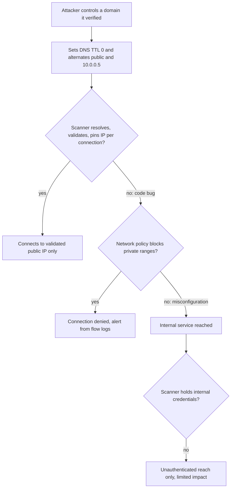
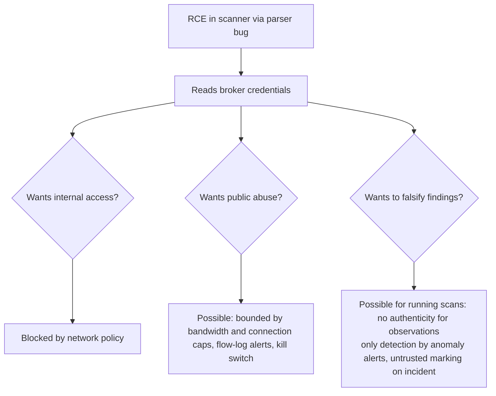
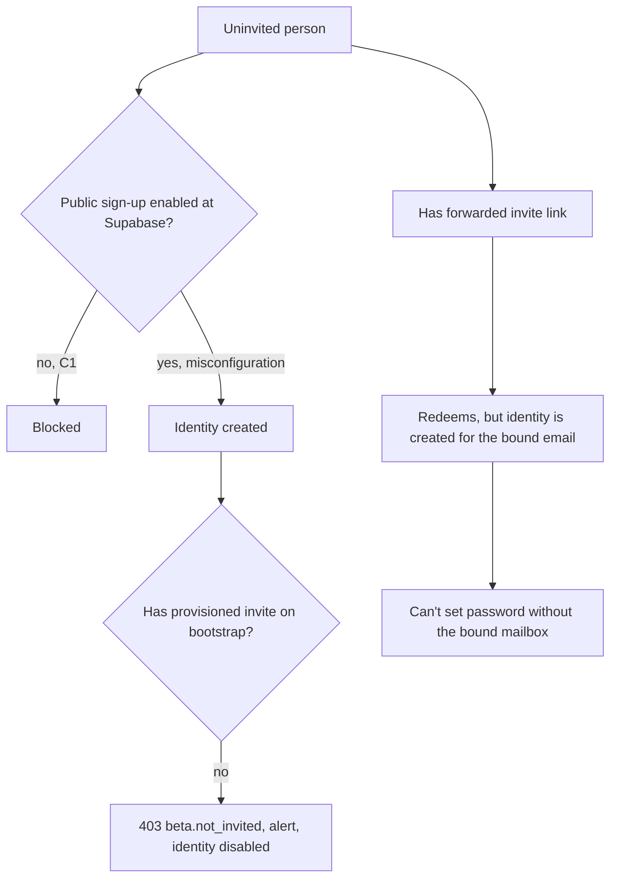

# VulnScope — Threat Model and Abuse Cases

| Field | Value |
|---|---|
| Status | **APPROVED v0.2 — Task 00.3 (approved by owner 2026-10-14, documentation/design level)** |
| Date | 2026-10-14 |
| Changelog | **v0.2:** T-403 and §4.1/§4.5 rewritten (consistency ≠ authenticity; image digest limits; explicit residual acceptance); §4.3 DNS completeness; new §4.11 cancellation/kill/Redis-outage; SAC-CAN-01…10 and SAC-DNS-01…12 added; SAC-ROE-03, SAC-SCN-05 reworded; §9 fail-closed rows; R-RES-02 rewritten, R-RES-13 added; TM-OD-05 added. **v0.1:** initial draft |
| Source of truth | PRD v0.2 (approved) · ARCHITECTURE v0.2 (approved) · ADR-0001…0015 (accepted) |
| Companions | `RULES_OF_ENGAGEMENT.md` (RoE-1) · `SECURITY_LAUNCH_GATES.md` |
| Method | Asset/actor inventory → STRIDE per trust boundary (TB-1…TB-9) → focus analyses → abuse cases → attack paths → security acceptance criteria (SAC) → fail-closed rules → residual risks |
| Rating | Likelihood (L/M/H) × Impact (L/M/H/Critical), qualitative, **after** planned controls |

This document describes **planned** controls. Nothing here is implemented yet. A control counts as "in place" only when its SAC test passes in the phase listed.

---

## 1. Assets

| ID | Asset | Why it matters |
|---|---|---|
| AS-01 | Tenant data: projects, scopes, findings, evidence, reports, AI interactions | Confidentiality between orgs (PRD FR-04) |
| AS-02 | Identities and sessions: Supabase JWTs, extension tokens | Account takeover |
| AS-03 | Secrets: Supabase service-role key, scope-token signing key, DB/Redis credentials, AI/email keys, broker credentials | Full compromise or abuse |
| AS-04 | Internal infrastructure: Postgres, Redis-core, API, worker, cloud metadata | SSRF target |
| AS-05 | Third-party websites and our scanner IP reputation | Unauthorized scanning, legal exposure (PRD R-01, R-08) |
| AS-06 | Integrity of findings, lifecycle and score | Trust; false clean bill of health (PRD R-05) |
| AS-07 | Authorization records (verification, consent, RoE acknowledgment) | Proof of permission |
| AS-08 | Audit log | Accountability, incident response |
| AS-09 | Extension users' browsing privacy | Chrome Web Store policy, user trust |
| AS-10 | AI budget and provider account | Cost abuse |
| AS-11 | Beta access (invite system) | Launch control (DEC-004) |

## 2. Threat actors

| ID | Actor | Capability | Primary goals |
|---|---|---|---|
| TA-01 | Anonymous internet attacker | HTTP requests to web/API, no account | Data theft, account takeover, DoS |
| TA-02 | Uninvited registrant | Knows the product; may hold a leaked or forwarded invite link | Bypass invite-only beta |
| TA-03 | Abusive customer (authenticated tenant) | Valid account and org; controls its own inputs | Scan third parties, read other tenants, farm quota, abuse AI |
| TA-04 | Low-privilege org member (viewer/analyst) | Valid membership | Escalate role, change scope/consent, exfiltrate |
| TA-05 | Former member / domain transferee | Had legitimate access or inherits a domain with stale proof | Keep scanning or reading after access should end |
| TA-06 | Malicious target website | Controls DNS answers, HTTP/TLS responses, headers, redirects, body content | SSRF, DNS rebinding, parser exploits, prompt injection, report injection |
| TA-07 | Compromised scanner (after RCE via parser/library bug) | Code execution inside the scanner container with its broker credentials | Pivot inward, abuse egress, falsify results |
| TA-08 | Supply-chain attacker | Malicious npm/PyPI package, compromised CI action, base image | Code execution in any component |
| TA-09 | Malicious page or extension in the user's browser | Scripts on pages the extension inspects; other extensions | Steal extension token, inject UI, exfiltrate |
| TA-10 | Compromised or misbehaving third party | Supabase, AI provider, email provider, hosting | Data exposure, auth bypass, outage |
| TA-11 | Operator error (us) | Misconfiguration, leaked secret, wrong deploy | Accidental exposure, scanning wrong targets |

## 3. STRIDE per trust boundary

Boundaries as defined in ARCHITECTURE §5. **S**poofing, **T**ampering, **R**epudiation, **I**nformation disclosure, **D**enial of service, **E**levation of privilege.

### TB-1 Browser → Web / API

| ID | STRIDE | Threat | Controls (source) | Rating | SAC |
|---|---|---|---|---|---|
| T-101 | S | Forged or expired JWT | Signature via JWKS, `iss`/`aud`/`exp`/`nbf` (ADR-0003) | L×H | SAC-AUTH-01 |
| T-102 | S | `alg=none` / algorithm confusion / unknown `kid` | Algorithm allowlist; reject unknown `kid` after one JWKS refresh | L×H | SAC-AUTH-02 |
| T-103 | E | Client sends another `org_id` or role in the body | Org only from the path + membership lookup; body `org_id` ignored (ADR-0005) | L×Critical | SAC-TEN-01 |
| T-104 | E | IDOR: guessing project/finding IDs of other orgs | Org-scoped repositories; 404 on foreign IDs | M×Critical | SAC-TEN-02 |
| T-105 | E | Missing permission on a new route | Startup check: every route declares a permission (deny by default) | M×H | SAC-TEN-03 |
| T-106 | I | XSS steals the in-memory/JS-readable JWT | Strict CSP (no inline script, nonces), escaped rendering, no `dangerouslySetInnerHTML` of untrusted data, short JWT TTL (ADR-0004) | M×H | SAC-WEB-01, SAC-WEB-02 |
| T-107 | T | CSRF on API | API reads no cookies; Bearer only; strict CORS allowlist | L×M | SAC-WEB-03 |
| T-108 | D | Request flooding, expensive endpoints | Rate limits (RoE §13), pagination caps, idempotency keys | M×M | SAC-RL-01 |
| T-109 | I | Verbose errors leak internals or other tenants' existence | Structured error codes, no stack traces, 404 for foreign IDs | L×M | SAC-API-01 |
| T-110 | R | User denies changing scope, consent or roles | Append-only audit events with actor, request ID, timestamp | L×M | SAC-AUD-01 |

### TB-2 Web server → API

| ID | STRIDE | Threat | Controls | Rating | SAC |
|---|---|---|---|---|---|
| T-201 | E | Web server holds a privileged service token that could be abused | **No** service token; the server forwards the user's own JWT (ADR-0004) | L×H | SAC-WEB-04 |
| T-202 | I | SSR caches one user's API response for another | No shared caching of authenticated responses; `Cache-Control: private, no-store` | M×H | SAC-WEB-05 |
| T-203 | I | Secrets in Vercel env or client bundle | Only public config in web env; bundle secret scan in CI | L×Critical | SAC-SEC-01 |

### TB-3 Extension → API

| ID | STRIDE | Threat | Controls | Rating | SAC |
|---|---|---|---|---|---|
| T-301 | S | Stolen extension token used elsewhere | Opaque, scoped (`projects:read`, `sync:write`), short-lived access (15 min), rotating refresh (7 days) with reuse detection that revokes the family; hashed at rest; revocable (ADR-0012) | M×M | SAC-EXT-01 |
| T-302 | E | Extension syncs observations to a project it isn't authorized for | API checks scope, membership, permission, active verification **and** authorization, exact origin match | L×M | SAC-EXT-02 |
| T-303 | T | Synced observation changes findings or score | Findings module has no dependency on `extension_observations` (AC-LC-06) | L×H | SAC-LC-06 |
| T-304 | I | Extension uploads secrets (cookie values, tokens, form data) | Sanitization in the extension **and** a server-side schema that rejects unknown fields and long values | M×H | SAC-EXT-03 |
| T-305 | D | Sync flood | Per-token and per-org rate limits; payload ≤ 64 KiB | M×L | SAC-RL-02 |

### TB-4 Core worker ↔ Scanner (scan broker)

| ID | STRIDE | Threat | Controls | Rating | SAC |
|---|---|---|---|---|---|
| T-401 | S | Forged scan job injected into `scan:jobs` | Ed25519 signature; scanner rejects unsigned/expired/mismatched jobs (ADR-0009); ACL denies `XADD` on `scan:jobs` for the scanner | L×Critical | SAC-SCN-01 |
| T-402 | E | Valid job widened (extra host/port/path) | All scope fields are inside the signed token; nothing outside it is used | L×Critical | SAC-SCN-02 |
| T-403 | T | Forged or falsified results | **Consistency checks only, not authenticity** (§4.5): results accepted only for `running` scans with a matching nonce, once; JSON Schema + size caps; scope/budget consistency; anomaly alerts. A party holding scanner credentials (including a compromised scanner) can still submit plausible fabricated observations. | M×H (residual R-RES-02) | SAC-SCN-03 |
| T-404 | I | Scanner reads core data | Separate Redis; ACL limited to `scan:*`; no Redis-core route | L×Critical | SAC-NET-02 |
| T-405 | D | Scanner floods `scan:results` or holds connections | Core trims streams; `maxmemory` + eviction policy for scan Redis; connection monitoring (§4.6) | M×M | SAC-SCN-04 |
| T-406 | R | Can't tell which scanner instance produced a result | Result includes instance ID + image digest; core logs both | L×M | SAC-SCN-05 |

### TB-5 Customer website → Scanner

| ID | STRIDE | Threat | Controls | Rating | SAC |
|---|---|---|---|---|---|
| T-501 | E | SSRF via DNS answer pointing to private/metadata IPs | Egress guard + network policy; whole host blocked if any answer is blocked (RoE §8) | M×Critical | SAC-SSRF-01…08 |
| T-502 | E | DNS rebinding between check and connect | Resolve-validate-pin per connection, peer-address check, no re-resolution (§4.3) | M×Critical | SAC-SSRF-04 |
| T-503 | E | Redirect to internal address or unauthorized host | Manual redirects; every hop through the guard; out-of-scope targets never requested (ARCHITECTURE §9.3) | M×Critical | SAC-SSRF-05, AC-LC-11 |
| T-504 | E | Parser RCE (HTTP, TLS, compression, cookie parsing) | Mature libraries pinned; caps (RoE §11); non-root, read-only FS, dropped capabilities; short-lived instances; fuzz tests on our parsers | L×H | SAC-SCN-06 |
| T-505 | D | Slowloris / huge or infinite responses / decompression bomb | Timeouts (RoE §7), byte caps, decompression ratio cap | M×L | SAC-SCN-07 |
| T-506 | T | Hostile header values meant for later stages (XSS in UI, PDF injection, prompt injection) | Treated as untrusted data end-to-end: truncated, escaped in UI and reports, delimited for AI | M×H | SAC-WEB-02, SAC-RPT-01, SAC-AI-01 |
| T-507 | S | Site serves different content to the scanner vs users (cloaking) | Accepted limitation; documented in UI and reports | M×M | — (R-RES-06) |

### TB-6 Worker ↔ AI provider

| ID | STRIDE | Threat | Controls | Rating | SAC |
|---|---|---|---|---|---|
| T-601 | T | Prompt injection from site-derived strings | Delimited untrusted-data fields; system prompt forbids following embedded instructions; output schema validation; references only from the rule catalog; no tools (ADR-0013) | M×M | SAC-AI-01…04 |
| T-602 | I | Secrets or PII sent to the provider | Redaction before send; only structured, already-sanitized evidence; no raw headers beyond evidence | L×H | SAC-AI-05 |
| T-603 | T | AI output claims "fixed" or alters state | AI output is display-only; findings module has no path from AI (AC-LC-06) | L×H | SAC-LC-06 |
| T-604 | D / cost | Budget exhaustion by one org | Per-org quota and monthly budget checked before the call; global cap | M×M | SAC-AI-06 |
| T-605 | I | Malicious output (script, links) rendered in UI | Escaped text + restricted Markdown subset; links only to catalog references | M×M | SAC-AI-07 |

### TB-7 API/worker → Postgres

| ID | STRIDE | Threat | Controls | Rating | SAC |
|---|---|---|---|---|---|
| T-701 | T/I | SQL injection | ORM with bound parameters; no string-built SQL; SAST rule | L×Critical | SAC-API-02 |
| T-702 | E | App role can alter schema or audit log | `vs_app` has DML only; no `UPDATE`/`DELETE` on `audit_events`; migrations via `vs_migrator` | L×H | SAC-DB-01 |
| T-703 | I | Unscoped query leaks other tenants | Scoped repositories; optional RLS (OAD-01) | M×Critical | SAC-TEN-02, SAC-TEN-04 |

### TB-8 Local extension data → Cloud

| ID | STRIDE | Threat | Controls | Rating | SAC |
|---|---|---|---|---|---|
| T-801 | I | Data leaves the browser without user action | Upload only on an explicit "Sync" click; no background sync | L×H | SAC-EXT-04 |
| T-802 | I | Browsing history collected | `activeTab` only; no `tabs`/`history`/`webRequest` broad permissions; no host permissions by default | L×H | SAC-EXT-05 |
| T-803 | E | Malicious page script drives the extension UI or reads its storage | Side panel isolated from page; no content-script messaging that accepts commands; storage in `chrome.storage.session` (not exposed to content scripts) | M×M | SAC-EXT-06 |

### TB-9 API/worker → Supabase Admin API

| ID | STRIDE | Threat | Controls | Rating | SAC |
|---|---|---|---|---|---|
| T-901 | E | Service-role key leaked → arbitrary identities | Key only in core-zone secret store; never in web/extension/logs; rotation runbook; usage audited | L×Critical | SAC-SEC-02 |
| T-902 | S | Identity created without invite | Public sign-up disabled (C1); atomic redemption (§4.8) | M×H | SAC-INV-01…07 |

## 4. Focus analyses (required topics)

### 4.1 Compromised scanner behaviour (TA-07)
Starting assumption: an attacker has code execution in one scanner container.

| Attacker action | Outcome | Why | Detection |
|---|---|---|---|
| Connect to Postgres, Redis-core, API, worker, metadata, any private range | **Blocked** | Network policy outside the process (ADR-0007) | Flow logs: denied connection attempts → alert |
| Read env/filesystem for secrets | Gets broker credentials + public keys only | Nothing else is mounted | — |
| Read pending jobs | **Possible** | ACL allows `XREADGROUP`/`XAUTOCLAIM` on `scan:jobs` | Unusual consumer names / claim rates |
| Ack jobs without results | **Possible** → scans fail at deadline | ACL allows `XACK` | Alert on "acked without result" rate |
| Publish falsified results | **Possible** for visible running scans | The scanner *is* the observer; nothing authenticates what it saw (§4.5) | §4.5 consistency checks and anomaly alerts (detection only, not prevention) |
| Traffic to arbitrary public hosts | **Possible** | §4.2 | NAT flow logs, volume anomaly |
| Modify cancel/kill flags | **Blocked** | Read-only ACL selectors | — |
| Forge jobs for other scanners | **Blocked** | No `XADD` on `scan:jobs`; signature required | — |
| Persist across restarts | **Limited** | Read-only FS, instances recycled after **50 jobs or 6 h**, image digest pinned at deploy | Platform-reported digest mismatch → alert (catches wrong images, not runtime compromise, §4.5) |

**Response:** kill switch → scale to zero → rotate broker password → review flow logs → rebuild image from a clean pipeline → mark results produced by the affected instance in the window as `untrusted` (findings created from them get flagged for re-scan).

### 4.2 Unauthorized public-host traffic
- **Normal operation:** prevented by the signed scope token checked before every connection and redirect hop (ADR-0009). Tests: SAC-SCN-02, AC-LC-11.
- **Compromised scanner:** *not* prevented by network policy, which can only express "public IP on 80/443". Planned mitigations:
  1. Egress bandwidth and connection-rate caps per scanner instance at the network layer: ≤ **50 new TCP connections/min** and ≤ **10 Mbit/s** per instance † (values confirmed against OAD-03 platform capabilities).
  2. Egress via a NAT gateway with flow logs; alert when distinct destination IPs per instance per 10 min exceed **3×** the number of hosts in its running scans.
  3. Autoscaling hard cap (max instances), so abuse volume is bounded.
  4. Kill switch + scale-to-zero runbook (RoE §14).
  5. **OAD-13 B (scope-enforcing egress proxy)** is the only design that makes per-scan scope hold under compromise. Decision required before external beta (LG-SCN-06).
- **Residual:** until OAD-13 is decided, a compromised scanner can send bounded traffic to arbitrary public hosts from our IPs (R-RES-01).

### 4.3 DNS rebinding

| Technique | Control |
|---|---|
| First answer public, second answer private (TTL 0) | Resolve once per connection, connect to *that* IP (pinning); no second resolution |
| Mixed answer set (public + private) | Any blocked address → whole host blocked (RoE §8.4) |
| Oversized answer hiding a private address past a reading limit | No reading limit: the complete answer is parsed; > 16 addresses → host rejected (`dns_answer_oversized`), never truncated (RoE §8.3) |
| Truncated UDP answer (`TC`) or answer cut mid-record | TCP retry; still incomplete → `dns_incomplete`, no connection (RoE §8.5) |
| Only one family answered (`A` ok, `AAAA` timed out) | Host `dns_incomplete`; no connection on the partial answer (RoE §8.2) |
| Address records for names outside the CNAME chain, CNAME loops | `dns_ambiguous`, no connection (RoE §8.6) |
| Merging answers from two resolvers | Never merged; each answer must be complete on its own (RoE §8.6) |
| IPv4-mapped / NAT64 / 6to4 / Teredo encodings of private IPv4 | Embedded IPv4 extracted and validated (ARCHITECTURE §9.2) |
| CNAME to an internal name | Public resolver can't resolve internal names; final IPs are validated anyway |
| Library re-resolves internally (e.g., happy-eyeballs or a proxy) | Custom connector that takes an IP; peer-address check after connect; proxies disabled |
| Redirect to a hostname that rebinds | Each hop re-enters the guard with fresh resolve-validate-pin |
| Verification probe rebinding | Same guard used for verification fetches |
| Network-level fallback | Network policy blocks private ranges even if code fails |

### 4.4 SSRF (beyond rebinding)

| Vector | Control | SAC |
|---|---|---|
| User-supplied URL fetched by API | API never fetches user URLs (ADR-0007, ADR-0008) | SAC-SSRF-06 |
| IP literals, decimal/octal/hex IPv4, `0`, `[::]`, userinfo `a@b`, non-default ports | Normalizer rejects at project creation; scanner re-validates | SAC-SSRF-01 |
| Metadata endpoints (`169.254.169.254`, `fd00:ec2::254`, GCP/Azure equivalents) | Blocked set + network policy; no IAM role anyway | SAC-SSRF-02 |
| Proxy env variables (`HTTP_PROXY`, `ALL_PROXY`) | Stripped from the container; client ignores env | SAC-SSRF-07 |
| Scheme confusion (`file:`, `gopher:`, `ftp:`) in `Location` | Only `http`/`https`; anything else → `invalid_redirect` | SAC-SSRF-05 |
| Report renderer fetching remote assets | PDF renderer sandboxed with network disabled; assets bundled | SAC-RPT-02 |
| Webhook/email features with URLs (future) | Out of MVP; any future outbound URL feature must go through the scanner zone | — |

### 4.5 Forged or falsified scanner results (revised v0.2)

**What is authenticated, and what isn't**

| Direction | Mechanism | Authenticates |
|---|---|---|
| Core → scanner (job) | Ed25519 signature by the core (ADR-0009) | That the **job** and its scope came from the core and weren't altered. It says **nothing** about results. |
| Scanner → core (result) | Broker ACL credentials + job nonce | Only that the sender holds scanner broker credentials and saw the job. A compromised scanner has both. |
| Observations inside the result | **None** | Nothing proves the headers, certificates or redirects reported are what the target actually sent. |

A signed job does **not** authenticate the returned observations. Adding a per-instance signing key to the scanner wouldn't change this: an attacker with code execution in the scanner can use that key too. Making observations authentic would need remote attestation of the running code (e.g., a trusted execution environment) or independent re-observation. Both are out of MVP scope.

**Consistency checks (what the core does).** These reject malformed, replayed, misrouted, or obviously impossible results. They **don't** detect a plausible fabrication.
1. Scan must be `running`; `job_nonce` must match; first valid result wins; later ones are logged and dropped.
2. JSON Schema (no extra fields), size ≤ 512 KiB, string caps.
3. Every observed request URL is inside the signed scope; request/DNS/byte counts ≤ RoE budgets; timestamps within the running window; `scan_ref` matches.
4. Instance ID and image digest recorded (§ below on why this is limited).
5. **Anomaly alerts** (detection, not prevention): many findings flip fail→pass in one scan while the TLS certificate serial is unchanged; results from one instance diverge from the project's history much more than others; unusual result timing.

**Why image-digest allowlisting doesn't stop fabrication**
- A digest in the result is **self-reported** by the scanner process. A compromised process can report any value.
- Even a **platform-reported** digest (from the orchestrator, not the payload) only proves which *image was started*. An attacker who exploits a parser bug runs their own logic *inside* a legitimate image. The digest stays correct while the behaviour is the attacker's.
- So digest allowlisting protects against **deploying the wrong image** (supply-chain or operator error, TA-08/TA-11). It doesn't protect against **runtime compromise** (TA-07).

**Compensating controls (reduce likelihood and blast radius, not eliminate)**
- Hardening and short life: non-root, read-only FS, no capabilities, recycle after 50 jobs or 6 h, pinned dependencies, parser fuzzing.
- Detection: anomaly alerts above, denied-egress alerts, "acked without result" alerts.
- Incident response: mark every result from the affected instance and window `untrusted`; findings resolved by those results go back to their previous state with a "re-scan required" flag; affected users are notified.
- Optional product control (open, TM-OD-05): require that a fail→resolved transition be confirmed by a second scan on a **different scanner instance** before it counts.

**Residual risk (R-RES-02), stated plainly:** a compromised scanner can submit plausible false observations for scans it can see. That can create false findings or wrongly resolve real ones until detected. External beta (S2) requires the owner's **explicit written acceptance** of this risk with the compensating controls above verified in place (launch gate LG-SCN-09). We make **no claim** of cryptographic integrity or authenticity for observations, in docs, UI or reports.

### 4.6 Redis Streams and ACL limitations
| Limitation | Effect | Mitigation |
|---|---|---|
| ACL selectors need **Redis ≥ 7.0**; some managed Redis products restrict custom ACLs | Planned ACL may be impossible on the chosen platform | OAD-03 requirement; if unsupported → OAD-07 B (HTTPS pull gateway) |
| ACLs scope by key, not by stream entry or consumer | Scanner can read all pending jobs and claim others' entries | Jobs carry no secrets; tokens are scanner-only |
| No per-user command rate or connection limit | Scanner can hold many connections or issue many reads | `maxclients`, network connection caps, monitoring |
| `XADD` size isn't limited by ACL | Scanner can write huge entries to `scan:results` | `proto-max-bulk-len` and `maxmemory` on scan Redis; core rejects > 512 KiB; core trims |
| ACL passwords are only as safe as their transport | Sniffing on the network | TLS to Redis in production; local dev without TLS documented |
| `XREADGROUP` is a write command | Needs write permission on `scan:jobs` | Selector restricts commands for that key to `XREADGROUP`/`XACK`/`XAUTOCLAIM` only |
| The exact command list Celery-free clients need may differ | ACL could break a client or be too wide | Verified with integration tests in 06.1 (SAC-SCN-08) |

### 4.7 Cross-tenant access
Paths considered: IDOR on any object (T-104), body-supplied `org_id` (T-103), list endpoints without filters (T-703), background jobs acting on stale membership (ADR-0005 rule 5), report/export links (signed, short-lived, org-checked on download), AI cache keyed without org (cache key includes `org_id`), search/filter params with foreign IDs, extension sync to a foreign project (T-302), audit log views.
Controls and test: the **cross-tenant suite** (SAC-TEN-02) runs every endpoint as user A against org B's object IDs and expects 404/403, plus list endpoints checked for zero foreign rows. It's a CI gate from 04.2 onward.

### 4.8 Invite bypass

| Bypass attempt | Control | SAC |
|---|---|---|
| Call Supabase `signUp` directly with the public anon key | Public sign-up disabled (C1) | SAC-INV-01 |
| Passwordless/OTP sign-in that would create a user | Disabled; negative test | SAC-INV-02 |
| OAuth first login creates user | OAuth providers disabled in MVP (C6) | SAC-INV-03 |
| Reuse a redeemed token | Status CAS: only `pending` redeems | SAC-INV-04 |
| Race two redemptions | Single conditional `UPDATE`; exactly one wins | SAC-INV-05 |
| Forwarded link used by someone else | Identity is created for the bound email; recipient can't set a password without that mailbox | SAC-INV-06 |
| Token enumeration / brute force | 256-bit tokens; uniform response; rate limits (RoE §13) | SAC-INV-07 |
| Identity exists without invite (misconfig) | `/me/bootstrap` → 403 + alert; orphan reconciler | SAC-INV-08 |
| Leaked service-role key | T-901 controls | SAC-SEC-02 |

### 4.9 Token theft

| Token | Theft path | Impact | Controls | Residual |
|---|---|---|---|---|
| Supabase access JWT (web) | XSS, malicious browser extension, shared machine | Act as user until expiry | CSP, escaping, JWT TTL ≤ **1 h** (target 15–60 min, confirmed in 03.1), logout revokes refresh token | Theft within TTL (R-RES-04) |
| Supabase refresh token (web) | Same | Longer session | Supabase refresh rotation and reuse detection (verify in 03.1); sign-out-everywhere | — |
| Extension access/refresh token | Malicious extension with broad permissions, local malware | Read user's verified projects, sync observations | Narrow scopes, 15 min access, 7 day rotating refresh, reuse detection, `chrome.storage.session`, dashboard revocation | Local malware is out of scope |
| Scope token | Read from scan broker | Only meaningful to a scanner | Short `exp` (scan deadline + 60 s, ≤ 5 min), bound to `scan_id` and nonce | — |
| Broker credentials | Scanner compromise | §4.1 | Rotation, short-lived instances | R-RES-01 |
| Service-role key / signing key / DB creds | Leak via logs, repo, CI | Critical | Secret store only, log redaction, secret scanning in CI and pre-commit, rotation runbooks | — |
| Verification challenge token | Shoulder-surfing, logs | Could verify someone else's domain only if they place it | Hashed at rest; shown once; bound to org/project/host | — |
| Invite token | Email forwarding, logs | Blocked by email binding | Fragment transport, hashed | — |

### 4.10 AI prompt injection
Vectors: `Server`/`X-Powered-By`/CSP values, cookie names, redirect `Location` values, certificate subject fields, and the user-supplied "context" (≤ **500 chars**, PRD FR-07).

Controls (ADR-0013):
1. Site-derived values are placed only in typed JSON fields marked `untrusted`, truncated to evidence limits, and never concatenated into instructions.
2. System prompt states that untrusted fields are data and must not be followed.
3. Output must match a strict JSON Schema (explanation, impact, steps, snippet, caveats, confidence, `reference_ids` from the catalog). Anything else is rejected and not shown.
4. The model has **no tools**, no browsing, no ability to call our API.
5. Output is rendered escaped, with a restricted Markdown subset; snippets shown as text; links only from catalog reference IDs.
6. AI can't change any state (AC-LC-06).
7. An evaluation set of injection fixtures (≥ **30** cases) runs in CI against the adapter with a recorded or mock provider; 09.4 adds live-provider runs (SAC-AI-02).

Residual: the model may still produce misleading but schema-valid advice (R-RES-05). Hence caveats, confidence, and "verify by re-scan" in the UI.

### 4.11 Cancellation, kill switch and control-channel loss (new in v0.2)

| Threat / failure | Control (RoE §14) | SAC |
|---|---|---|
| Cancel only prevents *future* requests while a slow in-flight request keeps reading for up to 15 s | Every phase is cancellable; abort closes sockets; cooperative abort ≤ 2 s, then `SIGKILL` of the per-scan child | SAC-CAN-01…06, -09 |
| Blocking OS DNS call can't be interrupted | Async stub resolver only; no `getaddrinfo` | SAC-CAN-01 |
| Kill switch missed because the scanner is mid-operation | Supervisor poll every 1 s, independent of the child's work | SAC-CAN-07 |
| Scan broker unavailable, so cancel/kill flags can't be read or written | Control staleness > 2.5 s → abort all children, refuse new work and jobs (fail closed) | SAC-CAN-08 |
| Scanner starts a scan without a working control channel | Job pickup requires a successful kill-flag read within the last 1.5 s | SAC-CAN-10 |
| Partial observations from an aborted scan used as if complete | Aborted scans publish only a `cancelled`/`control_unavailable` notice; interrupted rules `not_checked` | SAC-CAN-08 |
| Child ignores the cooperative abort (bug or compromise) | `SIGKILL` 2 s after the abort event | SAC-CAN-09 |

Residual: a compromised **supervisor** could ignore flags. Then only the infrastructure kill (scale to zero, ≤ 5 min) and egress caps apply (R-RES-13).

## 5. Abuse cases

| ID | Abuse case | Actor | Prevented / limited by | Residual |
|---|---|---|---|---|
| AB-01 | Scan a competitor's or victim's site | TA-03 | Verification + authorization (ADR-0015), invite-only beta, per-host limits | Someone with real technical control but no legal right (e.g., an agency past its contract) → attestation + ToS + abuse handling |
| AB-02 | Use VulnScope as a DoS amplifier | TA-03 | RoE §5–§6: ≤ 40 req/scan, 1 in flight, ≤ 20 scans/host/day | Negligible load |
| AB-03 | Probe internal networks / cloud metadata | TA-03, TA-06 | §4.3, §4.4 | — |
| AB-04 | Verify a domain via an upload feature on a site the attacker doesn't own (CMS, user-content path at `/.well-known/`) | TA-03 | HTTPS method only checks the exact well-known path, no redirects; authorization attestation; DNS method recommended in UI | Sites that let users write to `/.well-known/` (R-RES-03) |
| AB-05 | Keep scanning a domain after losing it (expired domain, ex-employee) | TA-05 | 30-day hard expiry, revalidation ≥ every 24 h before manual scans and always before scheduled ones; consent invalidated on role loss | Up to 24 h window |
| AB-06 | Many accounts or orgs to multiply quotas | TA-03 | Invite-only; per-user and per-host limits; invites capped per inviter | — |
| AB-07 | AI as a free general LLM | TA-03 | Structured input only, 500-char context, per-org quota, output schema | — |
| AB-08 | Malicious header values to attack report readers (PDF/HTML injection) | TA-06 | Auto-escaped templates, sandboxed renderer without network, evidence truncation | — |
| AB-09 | Abuse monitoring to scan persistently | TA-03, TA-05 | Opt-in, min 24 h interval, revalidation before each run, disable control | — |
| AB-10 | Viewer escalates to change scope/consent | TA-04 | Permission matrix (00.4); consent owner/admin only | — |
| AB-11 | Invite resale or spam to unvetted users | TA-03 | Invites issued by admin; team invites capped † per org (12.1); revocation | — |
| AB-12 | Synthetic "clean" report to deceive a client | TA-03 | Reports show coverage, status, timestamps, disclaimers; reports carry a verification ID; no score on incomplete scans | A user can still edit a PDF they downloaded |
| AB-13 | Extension used to collect other people's data | TA-03 | No background collection; sync only to verified, authorized origins | — |
| AB-14 | Social-engineering an owner into consenting to a scope | TA-03 | Consent screen shows exact hosts; nothing pre-checked; audit trail | Human error |
| AB-15 | Abuse complaint ignored | TA-11 | Abuse contact, 2-business-day review, per-host kill (RoE §15) | Process discipline |

## 6. Attack paths

*AP-1 SSRF via DNS rebinding: two independent layers must both fail, and even then no credentials are present. LG-NET-01 tests the network layer in production.*

*AP-2 Compromised scanner: the two residual capabilities are explicit (R-RES-01, R-RES-02).*

*AP-3 Invite bypass: C1 is the gate; bootstrap is the backstop; email binding stops forwarded links.*

## 7. Security controls index (traceability)

| Control | Defined in | Verified by |
|---|---|---|
| JWT verification, no browser DB access | ADR-0003, ARCH §6–§7 | SAC-AUTH-* |
| Bearer-only API, CORS | ADR-0004 | SAC-WEB-03 |
| Tenant isolation, RBAC | ADR-0005, ARCH §7 | SAC-TEN-* |
| Invite-only registration | ADR-0014, ARCH §7.1 | SAC-INV-* |
| Two brokers, Streams ACL | ADR-0006, ARCH §9.4 | SAC-SCN-04, -08, SAC-NET-02 |
| Scanner isolation, egress guard | ADR-0007, ARCH §9.2 | SAC-SSRF-*, SAC-NET-* |
| Verification by scanner | ADR-0008, ARCH §8.1 | SAC-VER-* |
| Signed scope tokens | ADR-0009, ARCH §8.3 | SAC-SCN-01, -02 |
| Deterministic rules, lifecycle | ADR-0010, ARCH §10 | AC-LC-01…11 |
| Score eligibility | ADR-0011, ARCH §11 | AC-SC-01…03 |
| Extension trust levels | ADR-0012, ARCH §13 | SAC-EXT-* |
| AI grounding | ADR-0013, ARCH §14 | SAC-AI-* |
| Control vs authorization | ADR-0015, ARCH §8.4 | SAC-AUTHZ-* |
| Scanner limits | RoE-1 | SAC-ROE-* |
| DNS completeness | RoE §8 | SAC-DNS-01…12 |
| Cancellation, kill switch, control-channel loss | RoE §14 | SAC-CAN-01…10 |
| Result handling (consistency, not authenticity) | THREAT_MODEL §4.5 | SAC-SCN-03, SAC-SCN-05, LG-SCN-09 |

## 8. Security acceptance criteria

Each SAC is a test or check with a pass condition. The **phase** column is where it must first pass; launch gates (SECURITY_LAUNCH_GATES.md) require all of them.

| ID | Criterion (pass condition) | Method | Phase |
|---|---|---|---|
| SAC-AUTH-01 | Requests with expired, wrong-`iss`, wrong-`aud`, bad-signature JWTs → 401 | Unit + integration | 03.1 |
| SAC-AUTH-02 | `alg=none`, HS/RS confusion, unknown `kid` → 401 | Unit | 03.1 |
| SAC-INV-01 | `signUp` with the anon key against local Supabase creates **no** user | Integration (local Supabase) | 03.2 |
| SAC-INV-02 | OTP/magic-link sign-in for an unknown email creates no user | Integration | 03.2 |
| SAC-INV-03 | No OAuth provider enabled in config (config check) | CI config test | 03.2 |
| SAC-INV-04 | Redeeming an already redeemed / expired / revoked token → uniform 410 | Integration | 03.2 |
| SAC-INV-05 | 50 parallel redemptions of one token → exactly 1 success | Concurrency test | 03.2 |
| SAC-INV-06 | Created identity email always equals the invite's bound email, regardless of request body | Integration | 03.2 |
| SAC-INV-07 | Redemption rate limits return 429 at RoE §13 thresholds | Integration | 03.3 |
| SAC-INV-08 | JWT for an identity without a provisioned invite → `403 beta.not_invited` on bootstrap + audit event | Integration | 03.2 |
| SAC-TEN-01 | Body/query `org_id` never changes the effective org | Integration | 04.2 |
| SAC-TEN-02 | Cross-tenant suite: every endpoint with foreign IDs → 404/403; lists return 0 foreign rows | Generated test suite, CI gate | 04.2 |
| SAC-TEN-03 | App startup fails if any route lacks a permission declaration | Unit | 04.2 |
| SAC-TEN-04 | (If OAD-01 = RLS) queries without `app.org_id` return no rows | Integration | 04.2 |
| SAC-AUTHZ-01 | Scan enqueue/dispatch refused without active authorization, or with a scope-hash mismatch, or an old RoE version | Integration | 05.4 |
| SAC-AUTHZ-02 | Only owner/admin can create consent; viewer/analyst → 403 | Integration | 05.4 |
| SAC-AUTHZ-03 | Authorization suspended when the consenting user loses owner/admin (if OAD-15 B) | Integration | 05.4 |
| SAC-VER-01 | Challenge single-use, hashed, expires at 72 h; new challenge invalidates old | Integration | 05.2 |
| SAC-VER-02 | HTTPS verification with any redirect → fail | Fixture | 05.3 |
| SAC-VER-03 | Transient DNS failure → `unknown` + scans blocked, not `revoked`; definite failure → `revoked` | Fixture | 05.3 |
| SAC-SCN-01 | Unsigned, expired, wrong-key or mismatched-`scan_id` job → rejected, no network activity | Unit + fixture | 06.1 |
| SAC-SCN-02 | Scanner makes zero requests outside the token scope (fixture servers log all hits) | Fixture | 06.3 |
| SAC-SCN-03 | Results for non-running scans, wrong nonce, duplicates, out-of-scope URLs, over-budget counts → rejected | Integration | 06.1 |
| SAC-SCN-04 | Oversized `scan:results` entries rejected; streams trimmed; scan Redis `maxmemory` set | Integration | 06.1 |
| SAC-SCN-05 | Each result records instance ID and the **platform-reported** image digest (where the platform provides it) next to the self-reported one; mismatch → alert. Documented as a wrong-image control, not an authenticity control (§4.5) | Integration | 06.1 |
| SAC-SCN-06 | Scanner container runs non-root, read-only FS, no capabilities (config test) | Container policy test | 06.2 |
| SAC-SCN-07 | Slow, oversized, and decompression-bomb fixtures stop at RoE limits | Fixture | 06.3 |
| SAC-SCN-08 | Scanner ACL: allowed commands work; `XADD scan:jobs`, `SET scan:kill`, `KEYS`, `DEL`, `CONFIG`, `XRANGE scan:results` → NOPERM | Integration with Redis ≥ 7 | 06.1 |
| SAC-SSRF-01 | Normalizer rejects IP literals, alt IPv4 notations, userinfo, non-default ports, IDN homograph mixed scripts † | Unit | 05.1 |
| SAC-SSRF-02 | Every range in the blocked set (ARCH §9.2) is blocked, including embedded IPv4 in IPv6 forms | Unit (table-driven) | 06.2 |
| SAC-SSRF-03 | Mixed DNS answers (public + private) → host blocked | Fixture DNS | 06.2 |
| SAC-SSRF-04 | Rebinding fixture (TTL 0, alternating answers) never yields a connection to a private address | Fixture DNS | 06.2 |
| SAC-SSRF-05 | Redirects to private IPs, other hosts, other ports, `file:`/`gopher:` → not requested | Fixture | 06.3 |
| SAC-SSRF-06 | No API code path performs outbound HTTP to user-supplied hosts (static check + test) | SAST rule | 06.2 |
| SAC-SSRF-07 | Setting `HTTP_PROXY`/`ALL_PROXY` doesn't change scanner behaviour | Fixture | 06.2 |
| SAC-SSRF-08 | CI fails if the scanner attempts any non-fixture connection | CI network sandbox | 06.2 |
| SAC-DNS-01 | Answer with **17** public addresses → `dns_answer_oversized`, zero connections | Fixture DNS | 06.2 |
| SAC-DNS-02 | Answer with 16 addresses where only the **16th** is private → `destination_blocked`, zero connections | Fixture DNS | 06.2 |
| SAC-DNS-03 | Regression for the v0.1 wording: 9 addresses with the **9th** private → `destination_blocked` | Fixture DNS | 06.2 |
| SAC-DNS-04 | UDP answer with `TC` set, complete TCP answer → full validation, then proceeds normally | Fixture DNS | 06.2 |
| SAC-DNS-05 | UDP `TC`, TCP fails or is truncated → `dns_incomplete`, zero connections | Fixture DNS | 06.2 |
| SAC-DNS-06 | `A` answers public, `AAAA` times out → `dns_incomplete`, zero connections | Fixture DNS | 06.2 |
| SAC-DNS-07 | CNAME loop and CNAME depth 9 → `dns_ambiguous` | Fixture DNS | 06.2 |
| SAC-DNS-08 | `A` record whose owner is outside the CNAME chain → `dns_ambiguous` | Fixture DNS | 06.2 |
| SAC-DNS-09 | Malformed packet, record cut mid-way, query-ID mismatch → `dns_malformed`, zero connections | Fixture DNS | 06.2 |
| SAC-DNS-10 | Primary `SERVFAIL`, secondary complete → proceeds on the secondary's answer only (no merge); both fail → transient error | Fixture DNS | 06.2 |
| SAC-DNS-11 | Public `A` plus `AAAA` `::ffff:10.0.0.1` / `64:ff9b::a00:1` → `destination_blocked` | Fixture DNS | 06.2 |
| SAC-DNS-12 | Verification TXT with 11 records or > 4 KiB → check fails `dns_answer_oversized`; during revalidation → `unknown` (not `revoked`) | Fixture DNS | 05.2 / 05.3 |
| SAC-NET-01 | From a **deployed** scanner: connections to RFC1918, link-local, metadata, Postgres, Redis-core are refused at network level | Live probe from staging | 13.1 |
| SAC-NET-02 | From a deployed scanner: Redis-core unreachable; only scan Redis reachable | Live probe | 13.1 |
| SAC-ROE-01 | Per-scan request, DNS, byte and hop budgets enforced at exact RoE values | Fixture | 06.4 |
| SAC-ROE-02 | Same-host requests serial with ≥ 500 ms gap | Fixture timing | 06.4 |
| SAC-ROE-03 | Umbrella for cancellation: SAC-CAN-01…10 all pass | Fixture timing | 06.4 |
| SAC-CAN-01 | Cancel while a DNS query is pending (fixture resolver delays 4 s) → query socket closed; no connect follows; network quiescence ≤ **5 s** after the flag write | Fixture timing (timestamps at fixture + scanner) | 06.4 |
| SAC-CAN-02 | Cancel during TCP connect to a black-holed address (SYN dropped) → ≤ 5 s | Fixture timing | 06.4 |
| SAC-CAN-03 | Cancel during a TLS handshake stalled after ServerHello → ≤ 5 s | Fixture timing | 06.4 |
| SAC-CAN-04 | Cancel during slow-drip headers (1 byte/s) → connection closed ≤ 5 s; partial headers discarded | Fixture timing | 06.4 |
| SAC-CAN-05 | Cancel during slow body read → connection closed ≤ 5 s; partial body discarded | Fixture timing | 06.4 |
| SAC-CAN-06 | Cancel during a pacing wait / between redirect hops → no next request; ≤ 5 s | Fixture timing | 06.4 |
| SAC-CAN-07 | Global kill with 4 concurrent scans on one instance → all quiescent ≤ 5 s; supervisor picks no new job while the flag is set | Fixture timing | 06.4 |
| SAC-CAN-08 | Scan broker made unreachable mid-scan → all children aborted, quiescence ≤ **6 s** after outage start; no new job; no observations published; core ends the scan `failed` | Fault injection | 06.4 |
| SAC-CAN-09 | Child made to ignore the cooperative abort (fault injection) → `SIGKILL` ≤ 2.1 s after the abort event; quiescence ≤ 5 s | Fault injection | 06.4 |
| SAC-CAN-10 | Supervisor refuses to read jobs when no successful kill-flag read happened in the last 1.5 s | Fault injection | 06.4 |
| SAC-ROE-04 | Only `GET`; no cookies/auth/query/body sent (fixture inspects requests) | Fixture | 06.3 |
| SAC-ROE-05 | One running scan per host across orgs | Integration | 06.4 |
| SAC-EXT-01 | Refresh-token reuse revokes the token family | Integration | 10.3 |
| SAC-EXT-02 | Sync to non-matching origin / unverified / unauthorized project → 409/403 | Integration | 10.4 |
| SAC-EXT-03 | Server rejects observation payloads with unknown fields, cookie values, long strings | Integration | 10.4 |
| SAC-EXT-04 | No network request from the extension without a user click (automated extension test) | E2E | 10.2 |
| SAC-EXT-05 | Manifest permissions limited to the approved list (CI check) | Static | 10.1 |
| SAC-EXT-06 | Content scripts (if any) accept no commands from pages | Static + E2E | 10.2 |
| SAC-WEB-01 | CSP without `unsafe-inline`/`unsafe-eval` on app pages; violations reported | E2E header test | 01.3 / 02.4 |
| SAC-WEB-02 | Malicious evidence strings (`<script>`, `javascript:` links, RTL overrides) render inert in UI | E2E | 08.3 |
| SAC-WEB-03 | API ignores cookies; CORS rejects unlisted origins | Integration | 03.1 |
| SAC-WEB-04 | Web server environment contains no privileged API/service tokens | CI config check | 03.1 |
| SAC-WEB-05 | Authenticated responses carry `Cache-Control: private, no-store` | Integration | 03.3 |
| SAC-API-01 | Error responses contain codes, no stack traces | Integration | 01.1+ |
| SAC-API-02 | SAST forbids raw SQL string building | CI | 01.1 |
| SAC-DB-01 | `vs_app` can't `ALTER`, and can't `UPDATE`/`DELETE` on `audit_events` | Integration | 04.3 |
| SAC-AUD-01 | Scope, consent, role, verification, exception, export, revocation actions create audit events | Integration | 04.3+ |
| SAC-RL-01 / -02 | Rate limits at RoE §13 values return 429 | Integration | per feature |
| SAC-AI-01 | Injection fixtures don't change output schema, references or instructions | Eval suite (≥ 30 cases) | 09.2 |
| SAC-AI-02 | Live-provider eval pass rate ≥ 95% of fixtures with 0 schema violations shown to users | Eval | 09.4 |
| SAC-AI-03 | Invalid model output is never shown; user sees a clear error | Integration | 09.2 |
| SAC-AI-04 | Output links only to catalog references | Unit | 09.3 |
| SAC-AI-05 | Redaction test: planted secrets/emails in evidence don't reach the provider request | Unit | 09.2 |
| SAC-AI-06 | Requests beyond org quota/budget refused before any provider call | Integration | 09.1 |
| SAC-AI-07 | Model output with HTML/JS renders inert | E2E | 09.3 |
| SAC-RPT-01 | Report templates auto-escape; injection fixtures render inert in HTML and PDF | Fixture | 11.3 |
| SAC-RPT-02 | Renderer has no network access | Container test | 11.3 |
| SAC-SEC-01 | Secret scanning (repo + client bundles) finds nothing | CI | 01.1 |
| SAC-SEC-02 | Service-role and signing keys absent from web/extension/scanner images and logs | CI image scan + log redaction test | 03.1 / 06.1 |
| SAC-LC-06 | = AC-LC-06 (no state change from AI or extension) | Integration | 07.5 / 10.4 |

## 9. Fail-closed behaviour (consolidated)

| Condition | Fail-closed result | Never |
|---|---|---|
| JWT/JWKS can't be verified | 401 / 503 | Accept unverified tokens |
| Membership or permission lookup fails | 503 | Default to allow |
| Supabase admin call fails during redemption | Invite back to `pending` or reconciled; no profile | Create a profile without a provisioned invite |
| Verification `unknown` or expired | Scans and sync blocked | Use the last known state |
| Authorization missing / scope hash mismatch / RoE outdated | Scan refused `scan.authorization_required` | Scan with older consent |
| Dispatch lock (1 scan per host) unavailable | Dispatch delayed → deadline → `failed` | Dispatch without the lock |
| Kill/cancel flags unreadable (no successful poll for > 2.5 s) | All children aborted (quiescence ≤ 6 s), no new jobs, nothing published but a `control_unavailable` notice; scan `failed` (RoE §14.4) | Continue scanning until Redis returns |
| Cancel/kill set while an operation is in flight | Operation interrupted, socket closed (≤ 5 s), `SIGKILL` fallback | Let the operation run to its timeout |
| Any blocked address in the answer | Host blocked (`destination_blocked`) | Pick another address and continue |
| DNS answer oversized, truncated, one family missing, ambiguous or malformed | Host rejected (`dns_answer_oversized` / `dns_incomplete` / `dns_ambiguous` / `dns_malformed`), no connection (RoE §8) | Validate a subset and proceed as if the whole answer was checked |
| TLS validation fails on fetch | Fetch not made; header rules `inconclusive` | Fetch with verification off |
| Budget/deadline reached | Remaining rules `not_checked`, scan `partial` | Silently skip and report `completed` |
| Result invalid / inconsistent | Scan `failed` `result.invalid` | Partially apply results |
| Observation truncated | Affected rules `inconclusive` | Evaluate as `pass` |
| AI output invalid | Not shown, error state | Show raw output |
| Rate limiter unavailable | 503 for limited endpoints | Unlimited access |
| Report renderer error | No report; error state | Report missing sections without marking them |

## 10. Residual risks

| ID | Risk | Rating | Owner decision / mitigation path |
|---|---|---|---|
| R-RES-01 | Compromised scanner can send bounded traffic to arbitrary public hosts | L×H | Caps + monitoring now; **OAD-13 decision before external beta** (LG-SCN-06) |
| R-RES-02 | Compromised scanner can submit plausible fabricated observations for scans it can see (false findings or wrongful resolution). Consistency checks don't authenticate observations; digest allowlisting doesn't stop runtime compromise (§4.5) | L×H | Hardening, short life, anomaly detection, untrusted-marking runbook; optional second-instance confirmation (TM-OD-05). **Explicit written owner acceptance required before S2 (LG-SCN-09).** No authenticity claim anywhere |
| R-RES-03 | Domains that let third parties write to `/.well-known/` can be "verified" by them | L×M | Attestation, abuse process; UI recommends DNS method; consider DNS-only for some TLDs/platforms post-MVP |
| R-RES-04 | Stolen JWT usable until expiry | M×M | Short TTL, CSP; BFF alternative (OAD-12 B) if XSS risk proves higher |
| R-RES-05 | AI gives plausible but wrong advice | M×M | Caveats, confidence, references, deterministic re-scan |
| R-RES-06 | Cloaking: site shows the scanner different content | M×M | Documented limitation |
| R-RES-07 | No DNSSEC validation; resolver spoofing could misdirect requests to a public attacker IP | L×M | Trusted resolvers over the network policy; DNSSEC post-MVP |
| R-RES-08 | Up to 24 h window between losing a domain and revalidation | L×M | Shorten if abuse is observed |
| R-RES-09 | Legal authorization is an attestation, not proven | M×H | ToS, consent records, abuse process, legal review (LG-LEG-01) |
| R-RES-10 | Supabase behaviour changes reopen sign-up paths | L×H | Negative tests (SAC-INV-01…03) in CI on each Supabase CLI upgrade |
| R-RES-11 | Supply-chain compromise (TA-08) | M×H | Lockfiles, pinned versions, dependency audit, image digest pinning, minimal CI permissions (01.1, 13.3) |
| R-RES-12 | Managed Redis may not support ACL selectors | M×M | OAD-03 criterion; fallback OAD-07 B |
| R-RES-13 | A compromised scanner **supervisor** can ignore cancel/kill flags | L×H | Infrastructure kill (scale to zero ≤ 5 min), egress caps, flow-log alerts; part of the LG-SCN-09 acceptance |

## 11. Assumptions
- A-TM-01: The production platform (OAD-03) can enforce per-service egress rules and private networking. **Unverified**; LG-SCN-02 depends on it.
- A-TM-02: Supabase supports disabling public sign-up while admin invites still work (C1, C2). **Verify in 03.1.**
- A-TM-03: Supabase access-token TTL is configurable to ≤ 1 h and refresh tokens rotate. **Verify in 03.1.**
- A-TM-04: Redis ≥ 7 with ACL selectors is available locally and on the chosen platform. **Verify in 06.1 / OAD-03.**
- A-TM-05: Beta cohort is small (≤ 50 orgs †), so manual abuse review is feasible.
- A-TM-06: Our own app's dependencies have no known critical vulnerabilities at launch (checked by LG-SUP-01).
- A-TM-07: The owner can provide owner-controlled sites for internal alpha and preview-mode FP measurement.

## 12. Open decisions raised or affected by 00.3

| ID | Decision | Recommendation | Needed by |
|---|---|---|---|
| OAD-13 | Scope enforcement outside the scanner | **Stays open** until platform capabilities and independent egress enforcement are evaluated; must be decided before S2 | 13.4 (LG-SCN-06) |
| OAD-15 | Consent suspended when consenting user loses owner/admin | DEC-034 — proposed; owner's provisional preference: accept | Final approval of 00.3 |
| OD-02 | Extension data retention | DEC-035 — proposed; owner's provisional preference: accept as beta defaults, subject to privacy/legal review (12.4, LG-LEG-01) | Final approval of 00.3 |
| OAD-05 | Revalidation policy | DEC-033 — proposed; owner's provisional preference: accept | Final approval of 00.3 |
| TM-OD-05 | Require a second scan on a different scanner instance before a fail→resolved transition counts | Evaluate in 07.5 (UX cost vs R-RES-02 reduction) | 07.5 |
| TM-OD-01 | Network egress caps for scanner instances (50 conn/min, 10 Mbit/s) | Accept as initial values; tune with OAD-03 | 06.2 |
| TM-OD-02 | Beta cohort size and invite caps per org | ≤ 50 orgs, ≤ 5 team invites per org † | 12.1 |
| TM-OD-03 | Body read for Tier 2 (mixed content) | Keep 256 KiB cap, features only, no raw body transfer | 07.4 |
| TM-OD-04 | External independent review provider and budget | Owner decision (cost) | before 13.4 |
